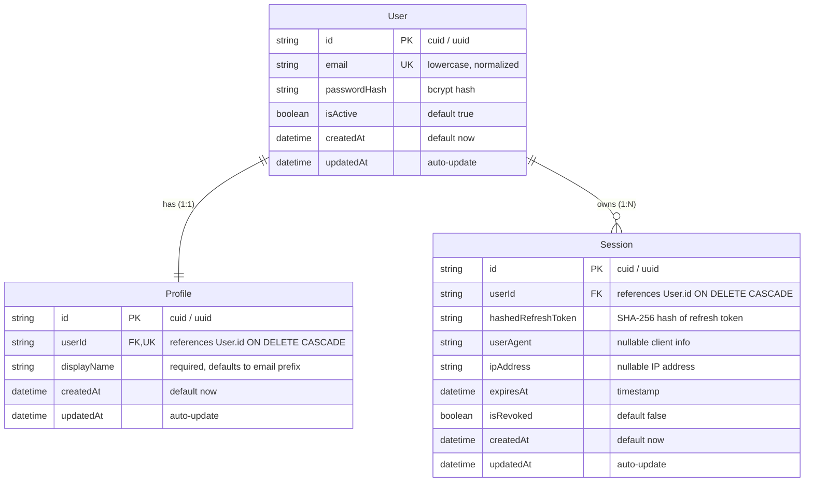

# Data Model: Authentication & User Management (Feature 001)

**Feature**: `001-auth-user-management`  
**Date**: 2026-11-04  
**Status**: Completed  

---

## 1. Entity Overview

The Authentication & User Management domain centers around three primary relational entities:
1. **`User`**: The root identity and credential record for authentication.
2. **`Profile`**: The user-facing display metadata (1:1 with `User`).
3. **`Session`**: The active, revocable refresh session grant (1:N with `User`).



---

## 2. Entity Specifications

### A. `User` (Identity & Credentials)

| Field | Type | Modifiers | Description |
|---|---|---|---|
| `id` | `String` | `@id @default(cuid())` | Unique user identifier. |
| `email` | `String` | `@unique` | Primary contact and sign-in email (strictly normalized to lowercase). |
| `passwordHash` | `String` | | Salted, securely hashed password (bcrypt work factor 12). |
| `isActive` | `Boolean` | `@default(true)` | Operational flag indicating active account standing. |
| `createdAt` | `DateTime` | `@default(now())` | Account creation timestamp (`Member since`). |
| `updatedAt` | `DateTime` | `@updatedAt` | Timestamp of last user record modification. |

**Indexes & Constraints**:
- `@@unique([email])`: Enforces global uniqueness across active accounts (`FR-002`).

---

### B. `Profile` (User Persona & Presentation)

| Field | Type | Modifiers | Description |
|---|---|---|---|
| `id` | `String` | `@id @default(cuid())` | Unique profile identifier. |
| `userId` | `String` | `@unique` | Foreign key referencing `User.id` (1:1 mapping). Cascades on user deletion. |
| `displayName` | `String` | | User display name (1–60 chars). Defaults to email username prefix if omitted (`FR-001`). |
| `createdAt` | `DateTime` | `@default(now())` | Timestamp of profile creation. |
| `updatedAt` | `DateTime` | `@updatedAt` | Timestamp of last profile update (`FR-014`). |

**Validation Rules**:
- `displayName`: Minimum 1 character, maximum 60 characters after trimming leading/trailing whitespace. Must not be empty.

---

### C. `Session` (Refresh Token & Session Lifecycle)

| Field | Type | Modifiers | Description |
|---|---|---|---|
| `id` | `String` | `@id @default(cuid())` | Unique session identifier (matches `sessionId` in JWT payload). |
| `userId` | `String` | | Foreign key referencing `User.id`. Cascades on user deletion. |
| `hashedRefreshToken` | `String` | | SHA-256 hash of the issued refresh token secret. |
| `userAgent` | `String?` | | Client browser / OS metadata for audit tracking. |
| `ipAddress` | `String?` | | Client IP address string. |
| `expiresAt` | `DateTime` | | Expiration timestamp (strictly 7 days from creation/refresh). |
| `isRevoked` | `Boolean` | `@default(false)` | Flag indicating if this session has been explicitly terminated (`FR-008`, `FR-016`). |
| `createdAt` | `DateTime` | `@default(now())` | Initial session creation timestamp. |
| `updatedAt` | `DateTime` | `@updatedAt` | Last token refresh rotation timestamp. |

**Indexes & Constraints**:
- `@@index([userId])`: Optimizes lookup and bulk invalidation of user sessions.
- `@@index([expiresAt])`: Enables efficient periodic cleanup of expired sessions.

---

## 3. Prisma Schema Definition (`apps/api/prisma/schema.prisma`)

```prisma
datasource db {
  provider = "postgresql"
  url      = env("DATABASE_URL")
}

generator client {
  provider = "prisma-client-js"
}

model User {
  id           String    @id @default(cuid())
  email        String    @unique
  passwordHash String
  isActive     Boolean   @default(true)
  createdAt    DateTime  @default(now())
  updatedAt    DateTime  @updatedAt

  profile      Profile?
  sessions     Session[]

  @@map("users")
}

model Profile {
  id          String   @id @default(cuid())
  userId      String   @unique
  displayName String
  createdAt   DateTime @default(now())
  updatedAt   DateTime @updatedAt

  user        User     @relation(fields: [userId], references: [id], onDelete: Cascade)

  @@map("profiles")
}

model Session {
  id                 String   @id @default(cuid())
  userId             String
  hashedRefreshToken String
  userAgent          String?
  ipAddress          String?
  expiresAt          DateTime
  isRevoked          Boolean  @default(false)
  createdAt          DateTime @default(now())
  updatedAt          DateTime @updatedAt

  user               User     @relation(fields: [userId], references: [id], onDelete: Cascade)

  @@index([userId])
  @@index([expiresAt])
  @@map("sessions")
}
```

---

## 4. Lifecycle & State Transitions

### A. User Registration & Sign-In
```
[Visitor Submits Registration]
   │
   ├─► Validate email syntax (RFC 5322) & password complexity (FR-003)
   ├─► Check email uniqueness
   │     ├─► If exists: Return generic non-confirming error (FR-005)
   │     └─► If new: Hash password (bcrypt 12)
   ├─► In single Prisma transaction:
   │     ├─► Create User
   │     └─► Create Profile (displayName = provided || email.split('@')[0])
   └─► Create Session & issue Access Token (JWT) + Refresh Token (Cookie)
```

### B. Session Refresh & Token Rotation
```
[Client encounters 401 or timer triggers refresh]
   │
   ├─► Read refresh_token cookie & extract sessionId
   ├─► Find Session by id where isRevoked = false AND expiresAt > now()
   │     ├─► Not found or expired: Clear cookies & return 401
   │     └─► Found: Compare SHA-256(token) against session.hashedRefreshToken
   │           ├─► Mismatch: Security breach! Invalidate session, return 401
   │           └─► Match: Generate new Access Token (15m) + new Refresh Token (7d)
   └─► Update session.hashedRefreshToken & session.expiresAt; return updated cookies
```

### C. Password Change (Session Revocation)
```
[User submits Password Change with current + new password]
   │
   ├─► Verify current password matches User.passwordHash
   │     └─► If mismatch: Return 400 Bad Request ("Incorrect current password")
   ├─► Hash new password (bcrypt 12) & update User.passwordHash
   ├─► Rotate current Session: Generate new tokens for the current sessionId
   └─► Invalidate other sessions: Update Session SET isRevoked = true WHERE userId = :id AND id != :currentSessionId (FR-016)
```
