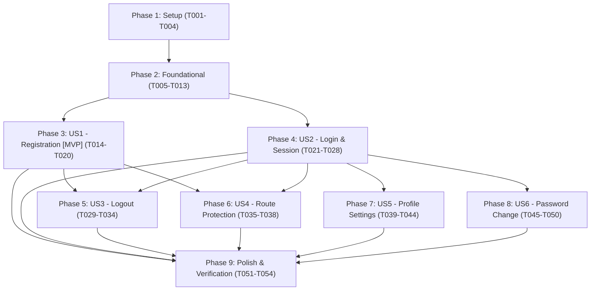

# Tasks: Authentication & User Management (Feature 001)

**Input**: Design documents from `specs/001-auth-user-management/`  
**Prerequisites**: [`plan.md`](file:///D:/VsCode/NestJS/dev-space/specs/001-auth-user-management/plan.md), [`spec.md`](file:///D:/VsCode/NestJS/dev-space/specs/001-auth-user-management/spec.md), [`data-model.md`](file:///D:/VsCode/NestJS/dev-space/specs/001-auth-user-management/data-model.md), [`ux-design.md`](file:///D:/VsCode/NestJS/dev-space/specs/001-auth-user-management/ux-design.md), [`contracts/auth.contract.ts`](file:///D:/VsCode/NestJS/dev-space/specs/001-auth-user-management/contracts/auth.contract.ts), [`quickstart.md`](file:///D:/VsCode/NestJS/dev-space/specs/001-auth-user-management/quickstart.md)  
**Organization**: Tasks are grouped by phase and user story to enable independent implementation and testing.

## Format: `[ID] [P?] [Story] Description with file path`

- **[P]**: Can run in parallel (different files, no dependencies)
- **[Story]**: User story identifier (US1, US2, US3, US4, US5, US6)
- File paths are explicitly specified for every task.

---

## Phase 1: Setup (Shared Infrastructure & Dependencies)

**Purpose**: Package dependencies, environment templates, and shared contracts initialization.

- [x] T001 Install Prisma, JWT, Passport, and validation packages in `apps/api/package.json` (`prisma`, `@prisma/client`, `bcryptjs`, `@types/bcryptjs`, `@nestjs/jwt`, `@nestjs/passport`, `passport`, `passport-jwt`, `@types/passport-jwt`, `cookie-parser`, `@types/cookie-parser`, `class-validator`, `class-transformer`)
- [x] T002 [P] Configure environment templates in `apps/api/.env.example` (`DATABASE_URL`, `JWT_ACCESS_SECRET`, `JWT_REFRESH_SECRET`, `COOKIE_DOMAIN`) and `apps/web/.env.example` (`NEXT_PUBLIC_API_URL`)
- [x] T003 [P] Define shared TypeScript contracts and DTOs in `packages/contracts/src/auth/auth.dto.ts` and `packages/contracts/src/auth/user.dto.ts` (`RegisterRequest`, `LoginRequest`, `AuthResponse`, `UserSummary`, `UserProfile`, `UpdateProfileRequest`, `ChangePasswordRequest`, `ApiErrorResponse`)
- [x] T004 Export authentication contracts in `packages/contracts/src/index.ts` and verify build via `pnpm --filter @devspace/contracts build`

---

## Phase 2: Foundational (Blocking Prerequisites)

**Purpose**: Core database schema, authentication security primitives, and base client context. MUST be completed before User Story tasks.

- [x] T005 Initialize Prisma schema in `apps/api/prisma/schema.prisma` with `User` (email unique, passwordHash), `Profile` (1:1 with User, displayName string 1-60 chars, onDelete: Cascade), and `Session` (userId index, hashedRefreshToken, expiresAt, isRevoked default false, onDelete: Cascade)
- [x] T006 Generate database migration `init_auth_users` and Prisma Client via `pnpm --filter @devspace/api exec prisma migrate dev --name init_auth_users` in `apps/api/prisma/migrations/`
- [x] T007 [P] Implement `PrismaService` and `PrismaModule` handling connection lifecycle in `apps/api/src/common/prisma/prisma.service.ts` and `apps/api/src/common/prisma/prisma.module.ts`
- [x] T008 [P] Implement `PasswordService` with bcryptjs hashing (work factor 12) and constant-time comparison in `apps/api/src/modules/auth/password.service.ts`
- [x] T009 [P] Implement JWT strategy and `JwtAuthGuard` reading `access_token` from request cookies in `apps/api/src/modules/auth/strategies/jwt.strategy.ts` and `apps/api/src/common/guards/jwt-auth.guard.ts`
- [x] T010 [P] Implement `@CurrentUser()` parameter decorator extracting typed `UserSummary` from active request in `apps/api/src/common/decorators/current-user.decorator.ts`
- [x] T011 Configure global `ValidationPipe` (whitelist and transform), `cookie-parser` middleware, and CORS with credentials support in `apps/api/src/main.ts`
- [x] T012 [P] Implement API client fetch wrapper with cookie handling and 401 refresh concurrency mutex in `apps/web/src/lib/api-client.ts`
- [x] T013 [P] Implement `AuthContext` and `useAuth` hook managing user state (`isLoading`, `isAuthenticated`, `user`) in `apps/web/src/features/auth/context/auth-context.tsx` and `apps/web/src/features/auth/hooks/use-auth.ts`

**Checkpoint**: Foundation ready — database, security guards, shared contracts, and client auth state are operational.

---

## Phase 3: User Story 1 - Account Registration & Initial Onboarding (Priority: P1) 🎯 MVP

**Goal**: Allow visitors to register with email, password, and optional display name, auto-create user and profile, establish session cookies, and enter the workspace.

**Independent Test**: Register at `/register` with valid credentials, verify account and profile are created in database, confirm `access_token` and `refresh_token` cookies are set, and confirm browser transitions to workspace.

- [x] T014 [P] [US1] Unit tests for `UsersService.createUser` and `AuthService.register` in `apps/api/test/unit/register.spec.ts`
- [x] T015 [US1] Implement `UsersService.createUser` in `apps/api/src/modules/users/users.service.ts` using Prisma transaction to create `User` (email normalized lowercase) and `Profile` (display name defaulting to email prefix if omitted verbatim per FR-001)
- [x] T016 [US1] Implement `AuthService.register` in `apps/api/src/modules/auth/auth.service.ts` validating email uniqueness, hashing password, creating `Session` record, and generating access and refresh tokens
- [x] T017 [US1] Implement `POST /api/auth/register` endpoint in `apps/api/src/modules/auth/auth.controller.ts` returning generic 400 error on duplicate email (FR-005) and setting httpOnly session cookies
- [x] T018 [P] [US1] Implement `RegisterForm` component in `apps/web/src/features/auth/components/register-form.tsx` with email, optional display name (placeholder hint), password, confirmation, and real-time FR-003 checklist (8+ chars, upper, lower, number)
- [x] T019 [US1] Implement registration page in `apps/web/src/app/(auth)/register/page.tsx` using centered 380px layout adhering to `ux-design.md`, wiring submit to `register` action and redirecting to `/workspaces`
- [x] T020 [US1] E2E integration test for registration flow and duplicate email enumeration protection in `apps/api/test/e2e/register.e2e-spec.ts`

**Checkpoint**: User Story 1 is functional and verifiable as a standalone MVP increment.

---

## Phase 4: User Story 2 - User Sign-In & Session Persistence (Priority: P1)

**Goal**: Allow registered users to log in securely, maintain active sessions across page reloads via cookies, and silently rotate refresh tokens.

**Independent Test**: Sign in with valid credentials, verify redirect to workspace, perform hard page refresh to confirm persistent auth state, and verify token rotation on `/api/auth/refresh`.

- [x] T021 [P] [US2] Unit tests for `AuthService.login` and `AuthService.refreshSession` in `apps/api/test/unit/login-refresh.spec.ts`
- [x] T022 [US2] Implement `AuthService.login` in `apps/api/src/modules/auth/auth.service.ts` verifying credentials with constant-time check, creating `Session` record, and generating JWT and refresh cookies
- [x] T023 [US2] Implement `AuthService.refreshSession` in `apps/api/src/modules/auth/auth.service.ts` validating unrevoked session hash, rotating refresh token, and issuing fresh access token
- [x] T024 [US2] Implement `POST /api/auth/login`, `POST /api/auth/refresh`, and `GET /api/auth/me` endpoints in `apps/api/src/modules/auth/auth.controller.ts`
- [x] T025 [P] [US2] Implement `LoginForm` component in `apps/web/src/features/auth/components/login-form.tsx` with email, password, reveal toggle, keyboard submit (`↵`), and generic error alert
- [x] T026 [US2] Implement login page in `apps/web/src/app/(auth)/login/page.tsx` adhering to centered 380px layout in `ux-design.md`, reading `redirect` query parameter for post-login destination
- [x] T027 [US2] Wire `AuthContext` to query `GET /api/auth/me` on mount in `apps/web/src/features/auth/context/auth-context.tsx` to restore session state without layout flicker
- [x] T028 [US2] E2E integration test for sign-in, token refresh rotation, and reload persistence in `apps/api/test/e2e/login-refresh.e2e-spec.ts`

**Checkpoint**: User Stories 1 and 2 operate seamlessly together with persistent sessions.

---

## Phase 5: User Story 3 - Sign-Out & Session Revocation (Priority: P2)

**Goal**: Allow users to explicitly log out, immediately revoking the active session in the database and purging client-side cookies.

**Independent Test**: Click sign out from user menu, verify session is marked `isRevoked: true` in database, verify cookies are cleared, and confirm subsequent requests to `/api/auth/me` return 401.

- [x] T029 [P] [US3] Unit tests for `AuthService.logout` in `apps/api/test/unit/logout.spec.ts`
- [x] T030 [US3] Implement `AuthService.logout` in `apps/api/src/modules/auth/auth.service.ts` setting `isRevoked: true` on active session record
- [x] T031 [US3] Implement `POST /api/auth/logout` endpoint in `apps/api/src/modules/auth/auth.controller.ts` clearing `access_token` and `refresh_token` cookies (`Max-Age=0`)
- [x] T032 [P] [US3] Implement `UserMenu` dropdown component in `apps/web/src/components/navigation/user-menu.tsx` showing initials avatar, user name, email, settings link, and sign-out action (strictly Feature 001 scope)
- [x] T033 [US3] Wire `logout` action in `apps/web/src/features/auth/context/auth-context.tsx` to invoke logout endpoint, clear client state, and redirect to `/login`
- [x] T034 [US3] E2E integration test for session revocation and cookie clearance on logout in `apps/api/test/e2e/logout.e2e-spec.ts`

**Checkpoint**: User Story 3 provides complete session termination and privacy protection.

---

## Phase 6: User Story 4 - Protected Route Redirection & Access Control (Priority: P2)

**Goal**: Protect private workspace and settings routes via edge middleware, redirecting unauthenticated visitors to `/login?redirect=...` and returning them after login.

**Independent Test**: Navigate to `/settings` in incognito window, verify redirect to `/login?redirect=%2Fsettings`, sign in, and verify automatic forwarding to `/settings`.

- [x] T035 [US4] Implement edge middleware in `apps/web/src/middleware.ts` inspecting auth cookies, redirecting unauthenticated traffic to `/login?redirect=<path>` and authenticated users away from public auth routes to `/workspaces`
- [x] T036 [P] [US4] Implement responsive application header in `apps/web/src/components/navigation/header.tsx` with dynamic unauthenticated (Sign In / Register buttons) and authenticated states (Brand + UserMenu)
- [x] T037 [US4] Update root layouts in `apps/web/src/app/layout.tsx` to wrap children with `AuthProvider` and mount application header
- [x] T038 [US4] Integration test for edge middleware route protection and redirect query parameter preservation in `apps/web/test/middleware.test.ts`

**Checkpoint**: All private routes and deep links are securely guarded.

---

## Phase 7: User Story 5 - Profile Viewing & Updates (Priority: P3)

**Goal**: Allow authenticated users to view their account metadata and update their display name with instant UI reflection.

**Independent Test**: Navigate to `/settings`, view registered email and member-since date, edit display name to a new value, click save, and confirm update appears across navigation header and persists on reload.

- [x] T039 [P] [US5] Unit tests for `UsersService.updateProfile` in `apps/api/test/unit/profile.spec.ts`
- [x] T040 [US5] Implement `UsersService.updateProfile` in `apps/api/src/modules/users/users.service.ts` validating and updating `displayName` (1–60 non-empty characters)
- [x] T041 [US5] Implement `PATCH /api/users/profile` protected endpoint in `apps/api/src/modules/users/users.controller.ts` returning updated `UserProfile`
- [x] T042 [P] [US5] Implement `ProfileForm` component in `apps/web/src/features/auth/components/profile-form.tsx` with read-only email, display name field, member-since date, and auto-dismissing toast feedback per `ux-design.md`
- [x] T043 [US5] Implement settings page in `apps/web/src/app/(dashboard)/settings/page.tsx` with two-column layout and vertical sub-navigation rendering the Profile tab
- [x] T044 [US5] E2E integration test for profile retrieval and display name update in `apps/api/test/e2e/profile.e2e-spec.ts`

**Checkpoint**: Profile viewing and updates are fully functional.

---

## Phase 8: User Story 6 - Account Password Change (Priority: P3)

**Goal**: Allow authenticated users to change their password by verifying current password, keeping the current session active while revoking all other sessions.

**Independent Test**: Submit valid current password and new password conforming to FR-003, verify password update succeeds, verify current browser remains logged in with rotated tokens, and verify other device sessions return 401.

- [x] T045 [P] [US6] Unit tests for `UsersService.changePassword` and session revocation in `apps/api/test/unit/change-password.spec.ts`
- [x] T046 [US6] Implement `UsersService.changePassword` in `apps/api/src/modules/users/users.service.ts` validating current password, hashing new password (bcrypt 12), rotating current session tokens, and revoking other sessions (`isRevoked = true` where `userId = :id AND id != :currentSessionId`)
- [x] T047 [US6] Implement `POST /api/users/change-password` protected endpoint in `apps/api/src/modules/users/users.controller.ts` returning success message
- [x] T048 [P] [US6] Implement `PasswordForm` component in `apps/web/src/features/auth/components/password-form.tsx` with current password, new password with FR-003 indicators, confirmation, and explanatory session note
- [x] T049 [US6] Mount `PasswordForm` in the Security & Password tab of `apps/web/src/app/(dashboard)/settings/page.tsx`
- [x] T050 [US6] E2E integration test for password change and cross-device session revocation in `apps/api/test/e2e/change-password.e2e-spec.ts`

**Checkpoint**: Password change and session invalidation rules are verified.

---

## Phase 9: Polish & Cross-Cutting Concerns

**Purpose**: Monorepo static verification, linting, production build checks, and quickstart validation.

- [x] T051 [P] Execute static typecheck with zero errors across all packages via `pnpm -r --parallel run typecheck`
- [x] T052 [P] Execute linter checks with zero warnings/errors via `pnpm -r --parallel run lint`
- [x] T053 Verify production build success across `@devspace/contracts`, `@devspace/api`, and `@devspace/web` via `pnpm build`
- [x] T054 Run end-to-end scenario validation following `specs/001-auth-user-management/quickstart.md`

---

## Dependencies & Execution Order



### Phase Dependencies
- **Setup (Phase 1)**: Independent. Can start immediately.
- **Foundational (Phase 2)**: Depends on Phase 1 completion. **BLOCKS all user stories**.
- **User Story 1 (P1 - MVP)**: Can start immediately once Phase 2 is complete.
- **User Story 2 (P1)**: Can start after Phase 2 is complete.
- **User Story 3 (P2)**: Depends on US1/US2 session infrastructure.
- **User Story 4 (P2)**: Depends on US1/US2 login flows and cookies.
- **User Story 5 (P3)**: Depends on authenticated session state from US2.
- **User Story 6 (P3)**: Depends on password and session revocation primitives from US2.
- **Polish (Phase 9)**: Runs after all desired user stories are implemented.

---

## Parallel Execution Opportunities

### Parallel Foundational Tasks (Phase 2)
```bash
# Can run simultaneously once Prisma models are defined:
T007: Implement PrismaService & PrismaModule
T008: Implement PasswordService (bcryptjs)
T009: Implement JwtAuthGuard & JwtStrategy
T010: Implement @CurrentUser() decorator
T012: Implement api-client fetch wrapper in apps/web
T013: Implement AuthContext & useAuth hook in apps/web
```

### Parallel User Story Tasks (Phase 3 & Phase 4)
```bash
# Backend endpoint and Frontend UI form can be developed in parallel:
T015-T017: Backend UsersService, AuthService, AuthController (Registration)
T018: Frontend RegisterForm component

T022-T024: Backend Login & Refresh endpoints
T025: Frontend LoginForm component

T040-T041: Backend Profile update endpoint
T042: Frontend ProfileForm component

T046-T047: Backend Password change endpoint
T048: Frontend PasswordForm component
```

---

## Implementation Strategy: MVP First

1. **Step 1: Setup & Foundation (T001 - T013)**: Build contracts, database models, migrations, and auth guards.
2. **Step 2: MVP Delivery - User Story 1 (T014 - T020)**: Implement registration end-to-end. Validate that a new visitor can register and enter an empty workspace.
3. **Step 3: Returning User Flow - User Story 2 (T021 - T028)**: Implement login, refresh token rotation, and page reload session restoration.
4. **Step 4: Session Control & Guarding - User Stories 3 & 4 (T029 - T038)**: Add logout, user menu dropdown, edge middleware route guards, and destination redirection.
5. **Step 5: Account Self-Service - User Stories 5 & 6 (T039 - T050)**: Implement settings page, display name updates, and password changes with session revocation.
6. **Step 6: Quality Gates & Verification (T051 - T054)**: Execute `typecheck`, `lint`, `build`, and run `quickstart.md` scenarios.
