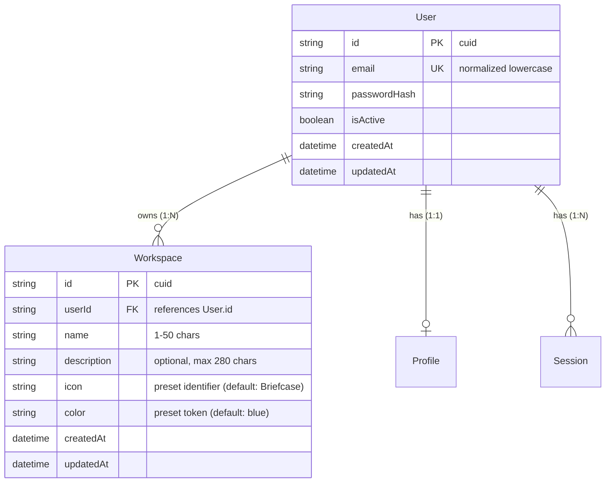
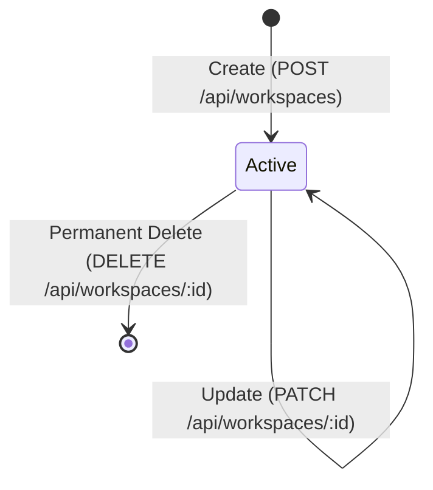

# Data Model: Workspace Management (Feature 002)

**Feature**: Workspace Management  
**Branch**: `002-workspace-management`  
**Date**: 2026-11-04  
**Status**: Ready for Implementation  

This document details the database schema, entity attributes, validation rules, relationships, and lifecycle states for Feature 002.

---

## 1. Entity-Relationship Overview



---

## 2. Prisma Schema Definition

In `apps/api/prisma/schema.prisma`:

```prisma
model User {
  id           String      @id @default(cuid())
  email        String      @unique
  passwordHash String
  isActive     Boolean     @default(true)
  createdAt    DateTime    @default(now())
  updatedAt    DateTime    @updatedAt

  profile      Profile?
  sessions     Session[]
  workspaces   Workspace[]

  @@map("users")
}

model Workspace {
  id          String   @id @default(cuid())
  userId      String
  name        String
  description String?
  icon        String   @default("Briefcase")
  color       String   @default("blue")
  createdAt   DateTime @default(now())
  updatedAt   DateTime @updatedAt

  user        User     @relation(fields: [userId], references: [id], onDelete: Cascade)

  @@index([userId])
  @@map("workspaces")
}
```

---

## 3. Attribute Specifications & Validation Rules

| Field | Type | Required | Defaults | Constraints / Validation | Description |
|---|---|:---:|---|---|---|
| `id` | `String` | Yes | `cuid()` | Unique CUID string | Primary key identifier for the workspace |
| `userId` | `String` | Yes | None | References `User.id` | Foreign key linking workspace to its owner |
| `name` | `String` | Yes | None | `MinLength(1)`, `MaxLength(50)`, trimmed | Human-readable title of the workspace |
| `description` | `String` | No | `null` | `MaxLength(280)` | Optional summary or purpose of workspace |
| `icon` | `String` | No | `"Briefcase"` | `IsIn(WORKSPACE_ICONS)` | Curated visual icon identifier |
| `color` | `String` | No | `"blue"` | `IsIn(WORKSPACE_COLORS)` | Curated theme color token |
| `createdAt` | `DateTime` | Yes | `now()` | Set automatically | Timestamp of workspace creation |
| `updatedAt` | `DateTime` | Yes | Auto | Updated on every mutation | Timestamp of last modification |

### Presets & Allowed Values

Defined in `packages/contracts`:
```typescript
export const WORKSPACE_ICONS = [
  'Briefcase',
  'Code',
  'BookOpen',
  'Terminal',
  'Compass',
  'Cpu',
  'Layers',
  'Boxes',
  'Flame',
  'Folder',
  'Sparkles',
  'User',
] as const;

export type WorkspaceIcon = typeof WORKSPACE_ICONS[number];

export const WORKSPACE_COLORS = [
  'slate',
  'blue',
  'indigo',
  'purple',
  'emerald',
  'amber',
  'rose',
  'cyan',
] as const;

export type WorkspaceColor = typeof WORKSPACE_COLORS[number];
```

---

## 4. Entity Lifecycle & State Transitions



1. **Creation**:
   - Authenticated user submits `CreateWorkspaceRequest`.
   - Name is trimmed of whitespace.
   - Defaults applied for `icon` (`"Briefcase"`) and `color` (`"blue"`) if omitted.
   - Assigned to `userId = req.user.id`.
   - Returns full `WorkspaceDto`.
2. **Update**:
   - Authenticated user submits `UpdateWorkspaceRequest`.
   - Only provided fields are updated; unmodified fields retain current values.
   - `updatedAt` timestamp is updated automatically.
3. **Deletion**:
   - Authenticated user types workspace name to confirm.
   - Database executes hard delete with `onDelete: Cascade`.
   - All future child entities (Areas, Projects) are removed atomically.

---

## 5. Multi-Tenant Isolation & Indexing Strategy

- **Tenant Isolation**: All queries must filter by `userId = currentUser.id`.
- **Indexing**: `@@index([userId])` optimizes the frequent query `SELECT * FROM workspaces WHERE user_id = $1 ORDER BY created_at DESC`.
- **Cascade Guarantee**: `User` cascade delete ensures that deleting a user account also purges all workspaces owned by that user.

