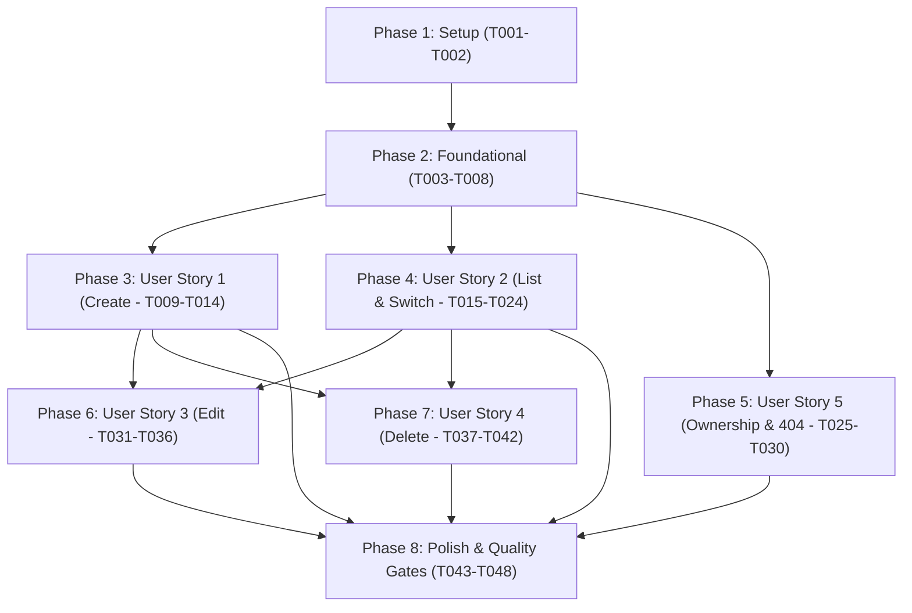

# Tasks: Workspace Management (Feature 002)

**Input**: Design documents from `specs/002-workspace-management/`  
**Prerequisites**: [`plan.md`](file:///d:/VsCode/NestJS/dev-space/specs/002-workspace-management/plan.md), [`spec.md`](file:///d:/VsCode/NestJS/dev-space/specs/002-workspace-management/spec.md), [`data-model.md`](file:///d:/VsCode/NestJS/dev-space/specs/002-workspace-management/data-model.md), [`ux-design.md`](file:///d:/VsCode/NestJS/dev-space/specs/002-workspace-management/ux-design.md), [`contracts/workspace.contract.ts`](file:///d:/VsCode/NestJS/dev-space/specs/002-workspace-management/contracts/workspace.contract.ts), [`quickstart.md`](file:///d:/VsCode/NestJS/dev-space/specs/002-workspace-management/quickstart.md)  
**Organization**: Tasks are grouped by phase and user story to enable independent implementation and testing.

## Format: `[ID] [P?] [Story] Description with file path`

- **[P]**: Can run in parallel (different files, no dependencies)
- **[Story]**: User story identifier (US1, US2, US3, US4, US5)
- File paths are explicitly specified for every task.

---

## Phase 1: Setup (Shared Contracts & Types)

**Purpose**: Shared TypeScript DTOs, interface contracts, and curated preset constants initialization.

- [x] T001 Define shared workspace contracts, DTOs, interfaces, and preset constants in `packages/contracts/src/workspaces/workspace.dto.ts` (`WorkspaceDto`, `CreateWorkspaceRequest`, `UpdateWorkspaceRequest`, `WorkspaceListResponse`, `WORKSPACE_ICONS` containing 12 curated icon names `['Briefcase', 'Code', 'BookOpen', 'Terminal', 'Compass', 'Cpu', 'Layers', 'Boxes', 'Flame', 'Folder', 'Sparkles', 'User']`, `WORKSPACE_COLORS` containing 8 curated tokens `['slate', 'blue', 'indigo', 'purple', 'emerald', 'amber', 'rose', 'cyan']`, `DEFAULT_WORKSPACE_ICON = 'Briefcase'`, `DEFAULT_WORKSPACE_COLOR = 'blue'`)
- [x] T002 Export workspace contracts in `packages/contracts/src/index.ts` and verify build via `pnpm --filter @devspace/contracts build`

---

## Phase 2: Foundational (Database Schema & Backend Module Skeleton)

**Purpose**: Core database schema, Prisma migration, validation DTOs, and client context primitives. MUST be completed before User Story tasks.

- [x] T003 Add `Workspace` model to `apps/api/prisma/schema.prisma` with `id` (`String @id @default(cuid())`), `userId` (`String`), `name` (`String`), `description` (`String?`), `icon` (`String @default("Briefcase")`), `color` (`String @default("blue")`), `createdAt` (`DateTime @default(now())`), `updatedAt` (`DateTime @updatedAt`), and index `@@index([userId])`, linking foreign key relation to `User` with `onDelete: Cascade`, and update `User` model with `workspaces Workspace[]`
- [x] T004 Generate database migration `add_workspaces` and update Prisma Client via `pnpm --filter @devspace/api exec prisma migrate dev --name add_workspaces` in `apps/api/prisma/migrations/`
- [x] T005 [P] Create backend validation DTOs with `class-validator` in `apps/api/src/modules/workspaces/dto/create-workspace.dto.ts` and `apps/api/src/modules/workspaces/dto/update-workspace.dto.ts` enforcing verbatim constraints (`name`: `@IsString()`, `@MinLength(1)`, `@MaxLength(50)`; `description`: `@IsOptional()`, `@IsString()`, `@MaxLength(280)`; `icon`: `@IsOptional()`, `@IsIn(WORKSPACE_ICONS)`; `color`: `@IsOptional()`, `@IsIn(WORKSPACE_COLORS)`)
- [x] T006 Create `WorkspacesModule` skeleton in `apps/api/src/modules/workspaces/workspaces.module.ts` and register it in `apps/api/src/app.module.ts`
- [x] T007 [P] Create client-side preset selector components in `apps/web/src/features/workspaces/components/icon-picker.tsx` (6x2 grid of 12 Lucide icons) and `apps/web/src/features/workspaces/components/color-picker.tsx` (row of 8 circular color swatches) adhering to `ux-design.md`
- [x] T008 [P] Initialize `WorkspaceContext` and `useWorkspaces` hook skeleton in `apps/web/src/features/workspaces/context/workspace-context.tsx` and `apps/web/src/features/workspaces/hooks/use-workspaces.ts` managing `workspaces: WorkspaceDto[]`, `activeWorkspace: WorkspaceDto | null`, and `isLoading: boolean`

**Checkpoint**: Foundation ready — database schema migrated, backend module skeleton registered, shared contracts verified, and base client context ready.

---

## Phase 3: User Story 1 - Create Workspace & Initial Selection (Priority: P1) 🎯 MVP

**Goal**: Authenticated user creates a new workspace with a mandatory name (1–50 chars) and optional icon, color, and description; the backend assigns ownership to the authenticated user and the frontend automatically activates the newly created workspace.

**Independent Test**: Navigate to the creation form, submit valid details, verify record in database, verify redirection to `/workspaces/:workspaceId`, and confirm the active workspace state is established.

- [x] T009 [P] [US1] Unit tests for `WorkspacesService.create` in `apps/api/test/unit/workspaces-create.spec.ts` verifying whitespace trimming on `name`, default fallbacks (`icon = "Briefcase"`, `color = "blue"`), and user association
- [x] T010 [US1] Implement `WorkspacesService.create` in `apps/api/src/modules/workspaces/workspaces.service.ts` associating the workspace with `userId = req.user.id`, trimming whitespace from `name`, applying defaults, and persisting via `prisma.workspace.create`
- [x] T011 [US1] Implement `POST /api/workspaces` endpoint in `apps/api/src/modules/workspaces/workspaces.controller.ts` with `@UseGuards(JwtAuthGuard)` and `@CurrentUser()` returning 201 Created with `WorkspaceDto`
- [x] T012 [P] [US1] Implement `CreateWorkspaceDialog` accessible modal component in `apps/web/src/features/workspaces/components/create-workspace-dialog.tsx` with autofocus name input, character counter (`X/50`), icon picker, color picker, description textarea (`X/280`), and inline error handling
- [x] T013 [US1] Wire `createWorkspace` action in `WorkspaceContext` (`apps/web/src/features/workspaces/context/workspace-context.tsx`) to post to `/api/workspaces`, prepend new workspace to local state, store ID in `localStorage` under `devspace:last_workspace_id`, and push router to `/workspaces/:newId`
- [x] T014 [US1] E2E integration test for workspace creation lifecycle, default application, and validation error rejection in `apps/api/test/e2e/workspaces-create.e2e-spec.ts`

**Checkpoint**: User Story 1 is functional and verifiable as a standalone MVP increment.

---

## Phase 4: User Story 2 - Workspace Listing, Empty State & Active Selection (Priority: P1)

**Goal**: Display all workspaces owned by the user, provide a header switcher dropdown to switch active workspace instantly (<500ms) via URL route navigation (`/workspaces/:workspaceId`), persist selection across page reloads, and present a welcoming onboarding empty state when zero workspaces exist.

**Independent Test**: Sign in with an account having 0 workspaces and verify the onboarding empty state renders; sign in with an account having multiple workspaces, open the header switcher, click a different workspace, verify URL updates to `/workspaces/:workspaceId`, and reload to confirm state retention.

- [ ] T015 [P] [US2] Unit tests for `WorkspacesService.findAllForUser` in `apps/api/test/unit/workspaces-list.spec.ts` verifying `orderBy: { createdAt: 'desc' }` and user isolation
- [ ] T016 [US2] Implement `WorkspacesService.findAllForUser` in `apps/api/src/modules/workspaces/workspaces.service.ts` querying `prisma.workspace.findMany` with `where: { userId }`
- [ ] T017 [US2] Implement `GET /api/workspaces` endpoint in `apps/api/src/modules/workspaces/workspaces.controller.ts` returning `WorkspaceListResponse`
- [ ] T018 [P] [US2] Implement `OnboardingEmptyState` component in `apps/web/src/features/workspaces/components/empty-state.tsx` displaying welcome message, onboarding value propositions, and primary CTA button triggering `CreateWorkspaceDialog`
- [ ] T019 [P] [US2] Implement `WorkspaceSwitcher` dropdown component in `apps/web/src/features/workspaces/components/workspace-switcher.tsx` with active workspace pill, icon styled in accent color, name truncation (160px), chevron, dropdown list with checkmark on active item, and `+ Create Workspace` action
- [ ] T020 [US2] Integrate `WorkspaceSwitcher` into `ApplicationHeader` in `apps/web/src/components/navigation/header.tsx` directly adjacent to the DevSpace brand mark when user is authenticated
- [ ] T021 [US2] Implement `WorkspaceOverview` canvas component in `apps/web/src/features/workspaces/components/workspace-overview.tsx` displaying large 44x44px icon container, title (`h1`), description, last-updated timestamp, and calm 2D boundary container preparing for future Areas
- [ ] T022 [US2] Implement root workspaces page in `apps/web/src/app/(dashboard)/workspaces/page.tsx` checking user workspaces: if 0 exist, render `OnboardingEmptyState`; if workspaces exist, redirect to cached `devspace:last_workspace_id` or first workspace
- [ ] T023 [US2] Implement workspace dynamic route in `apps/web/src/app/(dashboard)/workspaces/[workspaceId]/page.tsx` resolving workspace by param ID, updating active state and `localStorage`, and rendering `WorkspaceOverview`
- [ ] T024 [US2] E2E integration test for workspace listing, URL-based switching, and empty state rendering in `apps/api/test/e2e/workspaces-list-switch.e2e-spec.ts`

**Checkpoint**: User Stories 1 and 2 deliver the complete core workspace viewing, switching, and onboarding flow.

---

## Phase 5: User Story 5 - Ownership Isolation & Access Protection (Priority: P1)

**Goal**: Enforce strict server-side ownership verification on all workspace operations; return a uniform `404 Not Found` response for any nonexistent or foreign workspace ID (preventing resource enumeration); display a user-friendly 404 fallback page on the frontend.

**Independent Test**: User A creates Workspace A; User B requests `/api/workspaces/ws_A` and receives a 404 Not Found error without leaking entity data; User B navigates to `/workspaces/ws_A` and sees the "Workspace Not Found" screen with a button to return to their workspaces.

- [ ] T025 [P] [US5] Unit tests for `WorkspacesService.findOne` in `apps/api/test/unit/workspaces-ownership.spec.ts` verifying that querying another user's workspace returns `NotFoundException` identical to a non-existent ID
- [ ] T026 [US5] Implement atomic ownership query in `WorkspacesService.findOne` in `apps/api/src/modules/workspaces/workspaces.service.ts` querying `prisma.workspace.findFirst` with `where: { id, userId }` and throwing `NotFoundException('Workspace not found')` on null
- [ ] T027 [US5] Implement `GET /api/workspaces/:id` endpoint in `apps/api/src/modules/workspaces/workspaces.controller.ts` with `@UseGuards(JwtAuthGuard)` and `@CurrentUser()` returning `WorkspaceDto`
- [ ] T028 [P] [US5] Implement `WorkspaceNotFound` component in `apps/web/src/features/workspaces/components/workspace-not-found.tsx` displaying friendly 404 alert and CTA button navigating back to user's workspaces
- [ ] T029 [US5] Wire error boundary and 404 catch in `apps/web/src/app/(dashboard)/workspaces/[workspaceId]/page.tsx` to render `WorkspaceNotFound` when the route param ID cannot be resolved or returns 404
- [ ] T030 [US5] E2E security test for multi-tenant isolation, cross-account access rejection, and enumeration prevention in `apps/api/test/e2e/workspaces-ownership.e2e-spec.ts`

**Checkpoint**: Tenant boundaries are fully secured and verified against data leakage.

---

## Phase 6: User Story 3 - Edit Workspace Information (Priority: P2)

**Goal**: Allow authenticated users to edit the name, description, icon, and accent color of an existing workspace they own, preserving unmodified attributes.

**Independent Test**: Open edit modal for an existing workspace, change name and accent color while leaving description unchanged, submit changes, and confirm that header switcher and overview update immediately while description remains intact.

- [ ] T031 [P] [US3] Unit tests for `WorkspacesService.update` in `apps/api/test/unit/workspaces-update.spec.ts` verifying partial field updates, whitespace trimming, and preservation of unmodified fields
- [ ] T032 [US3] Implement `WorkspacesService.update` in `apps/api/src/modules/workspaces/workspaces.service.ts` verifying ownership via `where: { id, userId }`, updating only provided fields, and returning updated `WorkspaceDto`
- [ ] T033 [US3] Implement `PATCH /api/workspaces/:id` endpoint in `apps/api/src/modules/workspaces/workspaces.controller.ts` with `@UseGuards(JwtAuthGuard)` and `@CurrentUser()`
- [ ] T034 [P] [US3] Implement `EditWorkspaceDialog` modal in `apps/web/src/features/workspaces/components/edit-workspace-dialog.tsx` pre-populated with active workspace values, character counters, validation, and `"Save Changes"` action
- [ ] T035 [US3] Wire edit trigger button in `WorkspaceOverview` (`apps/web/src/features/workspaces/components/workspace-overview.tsx`) to open `EditWorkspaceDialog` and update `WorkspaceContext` state upon successful update
- [ ] T036 [US3] E2E integration test for partial workspace updates and input validation in `apps/api/test/e2e/workspaces-update.e2e-spec.ts`

**Checkpoint**: Workspace editing is fully operational and preserves data integrity.

---

## Phase 7: User Story 4 - Workspace Deletion with Confirmation (Priority: P2)

**Goal**: Allow authenticated users to permanently delete a workspace they own; enforce positive confirmation requiring typing the exact workspace name before unlocking deletion; cascade-delete all child records in the database; transition active selection safely to remaining workspace or onboarding empty state.

**Independent Test**: Open delete confirmation dialog for Workspace A, verify delete button is disabled until typing exact workspace name, confirm deletion, verify permanent removal from database and switcher, and verify automatic navigation to remaining workspace (or empty state).

- [ ] T037 [P] [US4] Unit tests for `WorkspacesService.remove` in `apps/api/test/unit/workspaces-delete.spec.ts` verifying atomic ownership verification and cascade deletion
- [ ] T038 [US4] Implement `WorkspacesService.remove` in `apps/api/src/modules/workspaces/workspaces.service.ts` executing `prisma.workspace.delete` on `where: { id, userId }` and throwing `NotFoundException` if not found or foreign
- [ ] T039 [US4] Implement `DELETE /api/workspaces/:id` endpoint in `apps/api/src/modules/workspaces/workspaces.controller.ts` returning `{ success: true }`
- [ ] T040 [P] [US4] Implement `DeleteWorkspaceDialog` modal in `apps/web/src/features/workspaces/components/delete-workspace-dialog.tsx` displaying destructive warning banner, name typing input, and delete button strictly disabled until exact string match
- [ ] T041 [US4] Wire delete action in `WorkspaceContext` (`apps/web/src/features/workspaces/context/workspace-context.tsx`) to execute deletion, remove workspace from state, clear cached ID if active workspace was deleted, and redirect to next remaining workspace or `/workspaces`
- [ ] T042 [US4] E2E integration test for type-to-confirm workspace deletion and fallback navigation in `apps/api/test/e2e/workspaces-delete.e2e-spec.ts`

**Checkpoint**: Complete workspace lifecycle (Create, List, Select, Edit, Delete) is operational and safe.

---

## Phase 8: Polish & Cross-Cutting Concerns

**Purpose**: Edge route protection, quality gate verifications, and end-to-end quickstart execution.

- [ ] T043 [P] Verify edge route protection in `apps/web/src/middleware.ts` ensuring all `/workspaces` and `/workspaces/:path*` routes redirect unauthenticated visitors to `/login?redirect=...`
- [ ] T044 Execute full monorepo typecheck gate: `pnpm typecheck`
- [ ] T045 Execute full monorepo lint gate: `pnpm lint`
- [ ] T046 Run all backend unit and E2E test suites: `pnpm --filter @devspace/api test` and `pnpm --filter @devspace/api run test:e2e`
- [ ] T047 Execute production build gate: `pnpm build` across `@devspace/contracts`, `@devspace/api`, and `@devspace/web`
- [ ] T048 Run manual end-to-end validation across all 6 scenarios in `specs/002-workspace-management/quickstart.md`

---

## Dependencies & Execution Order

### Phase Dependencies

### User Story Dependencies

- **User Story 1 (P1 - Create)**: Depends on Foundational phase. Can be built and tested independently as the MVP milestone.
- **User Story 2 (P1 - List & Switch)**: Depends on Foundational phase and integrates with US1 for switcher item population.
- **User Story 5 (P1 - Ownership)**: Depends on Foundational phase; ensures queries and endpoints enforce `where: { id, userId }`.
- **User Story 3 (P2 - Edit)**: Depends on US1 and US2 (edits existing workspaces from overview/switcher).
- **User Story 4 (P2 - Delete)**: Depends on US1 and US2 (deletes existing workspaces and redirects to remaining ones).
- **Polish (Phase 8)**: Depends on all user stories being implemented.

---

## Parallel Opportunities

- **Setup & Foundational**:
  - T005 (Backend DTOs), T007 (Icon/Color Pickers), and T008 (WorkspaceContext) can be developed in parallel once T001-T004 complete.
- **Within User Stories**:
  - Unit tests (`.spec.ts`) and frontend dialogs (`.tsx`) are marked `[P]` and can be authored in parallel with service implementations.
  - T012 (`CreateWorkspaceDialog`) can be developed in parallel with T009–T011 (Backend creation).
  - T018 (`OnboardingEmptyState`) and T019 (`WorkspaceSwitcher`) can be developed in parallel with T015–T017 (Backend listing).
  - T034 (`EditWorkspaceDialog`) can be developed in parallel with T031–T033 (Backend update).
  - T040 (`DeleteWorkspaceDialog`) can be developed in parallel with T037–T039 (Backend delete).

---

## Implementation Strategy

### MVP First (Phases 1, 2, and 3 - User Story 1)
1. Complete Phase 1: Shared contracts (`packages/contracts`).
2. Complete Phase 2: Database schema, migration, and backend module skeleton.
3. Complete Phase 3: User Story 1 (Workspace creation & direct navigation).
4. **STOP and VALIDATE**: Verify that creating a workspace works end-to-end, persists to PostgreSQL, and redirects to `/workspaces/:id`.

### Incremental Delivery
1. Foundation + US1 → Basic workspace creation working (MVP milestone).
2. Add US2 → Header switcher dropdown, URL-based switching, and onboarding empty state.
3. Add US5 → Multi-tenant security hardening and friendly 404 fallback screen.
4. Add US3 → Workspace editing with preservation of unmodified attributes.
5. Add US4 → Type-to-confirm safe deletion with database cascade.
6. Phase 8 → Run full typecheck, lint, automated test suites, production build, and quickstart scenarios.

