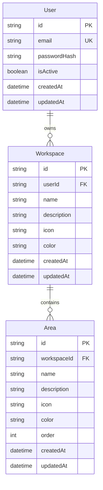
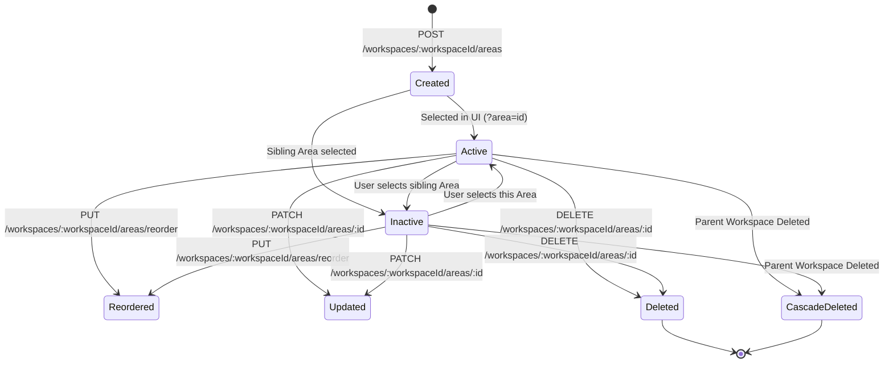

# Data Model: Feature 003 — Area Management

**Feature**: Area Management  
**Status**: Approved for Implementation  
**Date**: 2026-11-05  

This document details the relational data model, validation rules, constraints, and state lifecycles for **Feature 003: Area Management** in DevSpace.

---

## 1. Entity-Relationship Diagram



---

## 2. Relational Schema & Attributes

### `Area` Entity (`areas` table in PostgreSQL)

| Column | Type | Nullable | Default | Constraints / Validation | Description |
|---|---|:---:|:---:|---|---|
| `id` | `VARCHAR(30)` | No | `cuid()` | Primary Key | Unique internal identifier for the Area |
| `workspaceId` | `VARCHAR(30)` | No | - | Foreign Key -> `workspaces.id` (`ON DELETE CASCADE`) | The parent Workspace owning this Area |
| `name` | `VARCHAR(50)` | No | - | 1–50 characters, trimmed, non-empty | Human-readable name of the Area |
| `description` | `VARCHAR(280)` | Yes | `NULL` | Max 280 characters, trimmed | Optional purpose or scope summary |
| `icon` | `VARCHAR(30)` | No | `'Layers'` | Must belong to approved `WORKSPACE_ICONS` | Curated Lucide icon token |
| `color` | `VARCHAR(20)` | No | `'indigo'` | Must belong to approved `WORKSPACE_COLORS` | Curated theme color token |
| `order` | `INTEGER` | No | `0` | Non-negative integer (>= 0) | Sequence index for custom display order |
| `createdAt` | `TIMESTAMP(3)` | No | `CURRENT_TIMESTAMP` | - | Record creation timestamp |
| `updatedAt` | `TIMESTAMP(3)` | No | `CURRENT_TIMESTAMP` | Auto-updates on modification | Record modification timestamp |

---

## 3. Database Constraints & Indexes

```prisma
model Area {
  id          String    @id @default(cuid())
  workspaceId String
  name        String
  description String?
  icon        String    @default("Layers")
  color       String    @default("indigo")
  order       Int       @default(0)
  createdAt   DateTime  @default(now())
  updatedAt   DateTime  @updatedAt

  workspace   Workspace @relation(fields: [workspaceId], references: [id], onDelete: Cascade)

  @@index([workspaceId])
  @@index([workspaceId, order])
  @@unique([workspaceId, name])
  @@map("areas")
}
```

### Constraint Explanations:
1. **`onDelete: Cascade` on `workspace` relation**:
   - When a `Workspace` is permanently deleted, PostgreSQL cascades and deletes all related `Area` records atomically.
2. **`@@index([workspaceId])`**:
   - Accelerates parent workspace queries, authorization lookups, and deletion checks.
3. **`@@index([workspaceId, order])`**:
   - Optimizes ordered list queries (`SELECT * FROM areas WHERE workspace_id = $1 ORDER BY "order" ASC`).
4. **`@@unique([workspaceId, name])`**:
   - Enforces unique Area names per Workspace at the database tier. Combined with application-level lowercase trimming, prevents duplicate names within a workspace while permitting identical names across distinct workspaces.

---

## 4. Validation Rules & Boundaries

### Client & Server Validation Matrix

| Field | Validation Rules | Error Response |
|---|---|---|
| `name` | Mandatory; length 1–50 characters; leading/trailing whitespace trimmed; cannot be empty string | `400 Bad Request` ("Area name cannot be empty") |
| `name` (uniqueness) | Case-insensitive unique within the target `workspaceId` | `409 Conflict` ("An area with this name already exists in this workspace") |
| `description` | Optional; max 280 characters; leading/trailing whitespace trimmed | `400 Bad Request` ("Description must not exceed 280 characters") |
| `icon` | Optional (defaults to `'Layers'`); must match an entry in `WORKSPACE_ICONS` | `400 Bad Request` ("Invalid icon selection") |
| `color` | Optional (defaults to `'indigo'`); must match an entry in `WORKSPACE_COLORS` | `400 Bad Request` ("Invalid color selection") |
| `order` | Non-negative integer (`>= 0`) | `400 Bad Request` ("Order must be a non-negative integer") |
| `areaIds` (reorder) | Array of strings; must contain exact set of existing Area IDs for the target workspace without duplicates or foreign IDs | `400 Bad Request` ("Invalid reorder payload: Area IDs mismatch") |

---

## 5. Lifecycle & State Transitions



### Transition Descriptions:
- **Creation**:
  - Automatically assigned `order = max(existing_order) + 1` (or `0` if first Area).
  - Automatically marked as the active selection in the client router (`?area={id}`).
- **Active / Inactive Navigation**:
  - Driven by the URL query parameter `?area={id}`.
  - No database state mutation is needed for selection; the selection is entirely client-state and URL-reflected.
- **Reordering**:
  - Client sends full ordered array `[id1, id2, id3, ...]`.
  - Service executes a single Prisma transaction reassigning `order = index` for each ID.
- **Deletion**:
  - Permanently deletes the record from `areas`.
  - Client automatically reassigns active selection to the nearest sibling Area or transitions to empty state if zero Areas remain.

