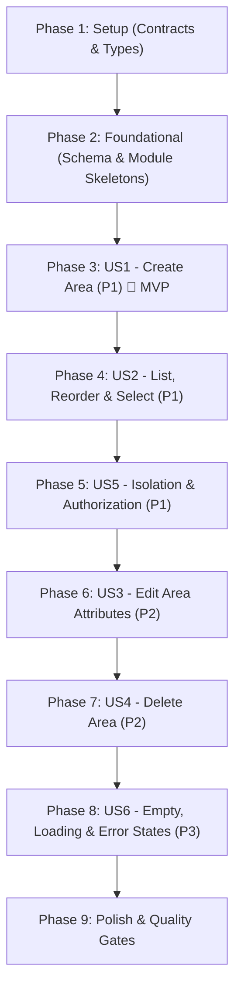

# Tasks: Area Management (Feature 003)

**Input**: Design documents from `specs/003-area-management/`  
**Prerequisites**: [`plan.md`](file:///d:/VsCode/NestJS/dev-space/specs/003-area-management/plan.md), [`spec.md`](file:///d:/VsCode/NestJS/dev-space/specs/003-area-management/spec.md), [`data-model.md`](file:///d:/VsCode/NestJS/dev-space/specs/003-area-management/data-model.md), [`ux-design.md`](file:///d:/VsCode/NestJS/dev-space/specs/003-area-management/ux-design.md), [`contracts/area.contract.ts`](file:///d:/VsCode/NestJS/dev-space/specs/003-area-management/contracts/area.contract.ts), [`quickstart.md`](file:///d:/VsCode/NestJS/dev-space/specs/003-area-management/quickstart.md)  
**Organization**: Tasks are grouped by logical phase and prioritized user story to enable independent implementation and verification.

## Format: `[ID] [P?] [Story] Description with file path`

- **[P]**: Can run in parallel (different files, no dependencies)
- **[Story]**: User story identifier (`US1`, `US2`, `US3`, `US4`, `US5`, `US6`)
- Exact file paths are specified for every task.

---

## Phase 1: Setup (Shared Contracts & Types)

**Purpose**: Shared TypeScript DTOs, request/response contracts, and preset defaults.

- [ ] T001 [P] Define shared area contracts and interfaces in `packages/contracts/src/areas/area.dto.ts` exporting `DEFAULT_AREA_ICON = 'Layers'`, `DEFAULT_AREA_COLOR = 'indigo'`, `AreaDto`, `CreateAreaRequest`, `UpdateAreaRequest`, `ReorderAreasRequest`, and `AreaListResponse` reusing `WorkspaceIcon` and `WorkspaceColor`
- [ ] T002 Export area contracts in `packages/contracts/src/index.ts` and verify build via `pnpm --filter @devspace/contracts build`

---

## Phase 2: Foundational (Database Schema, Migration & Module Skeletons)

**Purpose**: Core database schema, Prisma migration, validation DTOs, and base client context. MUST be completed before user stories.

- [ ] T003 Add `Area` model to `apps/api/prisma/schema.prisma` with `id` (`String @id @default(cuid())`), `workspaceId` (`String`), `name` (`String`), `description` (`String?`), `icon` (`String @default("Layers")`), `color` (`String @default("indigo")`), `order` (`Int @default(0)`), `createdAt` (`DateTime @default(now())`), `updatedAt` (`DateTime @updatedAt`), indexes `@@index([workspaceId])` and `@@index([workspaceId, order])`, compound unique constraint `@@unique([workspaceId, name])`, relation `workspace Workspace @relation(fields: [workspaceId], references: [id], onDelete: Cascade)`, and update `Workspace` model with `areas Area[]`
- [ ] T004 Generate database migration `add_areas` and generate Prisma Client via `pnpm --filter @devspace/api exec prisma migrate dev --name add_areas` in `apps/api/prisma/migrations/`
- [ ] T005 [P] Create backend validation DTOs with `class-validator` in `apps/api/src/modules/areas/dto/create-area.dto.ts`, `apps/api/src/modules/areas/dto/update-area.dto.ts`, and `apps/api/src/modules/areas/dto/reorder-areas.dto.ts` enforcing constraints (`name`: `@IsString()`, `@MinLength(1)`, `@MaxLength(50)`; `description`: `@IsOptional()`, `@IsString()`, `@MaxLength(280)`; `icon`: `@IsOptional()`, `@IsIn(WORKSPACE_ICONS)`; `color`: `@IsOptional()`, `@IsIn(WORKSPACE_COLORS)`; `areaIds`: `@IsArray()`, `@IsString({ each: true })`)
- [ ] T006 Create `AreasModule` skeleton in `apps/api/src/modules/areas/areas.module.ts` and register it in `apps/api/src/app.module.ts`
- [ ] T007 [P] Initialize `AreaContext` and `useAreas` hook skeleton in `apps/web/src/features/areas/context/area-context.tsx` and `apps/web/src/features/areas/hooks/use-areas.ts` managing `areas: AreaDto[]`, `activeArea: AreaDto | null`, `isLoading: boolean`, and `error: string | null` for a given `workspaceId`

**Checkpoint**: Foundation ready — database schema migrated, backend module skeleton registered, shared contracts verified, and base client context ready.

---

## Phase 3: User Story 1 - Create Area within Workspace (Priority: P1) 🎯 MVP

**Goal**: Authenticated user creates a new Area with mandatory name (1–50 chars, trimmed, unique per workspace) and optional icon, color, and description within the active workspace. The backend assigns sequential order and verifies workspace ownership; the frontend automatically selects the newly created Area.

**Independent Test**: Open an existing workspace, open Area creation modal, submit valid details, verify record in database with sequential `order`, and confirm the browser activates the newly created Area.

- [ ] T008 [P] [US1] Unit tests for `AreasService.create` in `apps/api/test/unit/areas-create.spec.ts` verifying workspace ownership verification, whitespace trimming on `name`, default values (`icon = "Layers"`, `color = "indigo"`), sequential `order = max(order) + 1`, and duplicate name conflict rejection (`409 Conflict`)
- [ ] T009 [US1] Implement `AreasService.create` in `apps/api/src/modules/areas/areas.service.ts` validating workspace ownership (`where: { id: workspaceId, userId }`), trimming name, verifying case-insensitive uniqueness within workspace, computing sequential order, and creating record via `prisma.area.create`
- [ ] T010 [US1] Implement `POST /api/workspaces/:workspaceId/areas` endpoint in `apps/api/src/modules/areas/areas.controller.ts` with `@UseGuards(JwtAuthGuard)` and `@CurrentUser()` returning 201 Created with `AreaDto`
- [ ] T011 [P] [US1] Implement `CreateAreaDialog` accessible modal component in `apps/web/src/features/areas/components/create-area-dialog.tsx` with autofocus name input, character counter (`X/50`), `<IconPicker />`, `<ColorPicker />`, description textarea (`X/280`), real-time duplicate name validation, and submission pending state
- [ ] T012 [US1] Wire `createArea` action in `AreaContext` (`apps/web/src/features/areas/context/area-context.tsx`) to post to `/api/workspaces/:workspaceId/areas`, append new area to state, set active area, update URL query parameter to `?area=:newAreaId`, and display success toast
- [ ] T013 [US1] E2E integration test for area creation lifecycle, sequential order calculation, and duplicate name rejection in `apps/api/test/e2e/areas-create.e2e-spec.ts`

**Checkpoint**: User Story 1 is functional and verifiable as a standalone MVP increment.

---

## Phase 4: User Story 2 - Area Listing, Reordering & Active Selection (Priority: P1)

**Goal**: Display all Areas belonging to the active workspace in sequential custom order, provide smooth single-click tab switching updating the URL query (`/workspaces/:workspaceId?area=:areaId`) in <300ms, and support intuitive drag-and-drop and accessible keyboard reordering (`Alt+ArrowLeft/Right`) persisted atomically via `PUT /workspaces/:workspaceId/areas/reorder`.

**Independent Test**: Navigate to a workspace with multiple areas, verify tabs render in stored sequence, switch tabs to confirm URL and view updates without page unmounting, reorder tabs via drag or keyboard, and reload to confirm new order is persisted.

- [ ] T014 [P] [US2] Unit tests for `AreasService.findAllForWorkspace` and `AreasService.reorder` in `apps/api/test/unit/areas-list-reorder.spec.ts` verifying `orderBy: { order: 'asc' }`, atomic transaction execution, and rejection of foreign/missing ID payloads
- [ ] T015 [US2] Implement `AreasService.findAllForWorkspace` in `apps/api/src/modules/areas/areas.service.ts` verifying workspace ownership and returning areas ordered by `order: 'asc'`
- [ ] T016 [US2] Implement `AreasService.reorder` in `apps/api/src/modules/areas/areas.service.ts` validating that the payload IDs match the workspace area set exactly and executing an atomic `prisma.$transaction` updating `order = index`
- [ ] T017 [US2] Implement `GET /api/workspaces/:workspaceId/areas` and `PUT /api/workspaces/:workspaceId/areas/reorder` endpoints in `apps/api/src/modules/areas/areas.controller.ts`
- [ ] T018 [P] [US2] Implement `AreaTabItem` component in `apps/web/src/features/areas/components/area-tab-item.tsx` with active accent pill, theme icon, truncated title (`max-w-[130px] sm:max-w-[180px]`) with native `title` and tooltip, drag handle with hover tooltip, and accessible keyboard reorder handlers (`Alt+ArrowLeft` / `Alt+ArrowRight`) announcing position via `aria-live="polite"`
- [ ] T019 [P] [US2] Implement `AreaNavigationStrip` component in `apps/web/src/features/areas/components/area-navigation-strip.tsx` with `role="tablist"`, horizontal scroll track, edge gradient mask, and pinned non-scrolling trailing slot housing the `+ New Area` button
- [ ] T020 [P] [US2] Implement `AreaCanvas` component in `apps/web/src/features/areas/components/area-canvas.tsx` with `role="tabpanel"`, streamlined 48px domain status bar (32x32 theme icon, `h2` title, "Area X of Y" sequence badge, description, `[Edit Area]`, `[Delete Area]`), and the future project staging canvas
- [ ] T021 [US2] Wire active Area synchronization in `AreaContext` (`apps/web/src/features/areas/context/area-context.tsx`) reading `useSearchParams().get('area')`, supporting shallow URL navigation via `router.replace('?area=' + id, { scroll: false })`, caching last-visited area in `localStorage` under `devspace:last_area_${workspaceId}`, and optimistic reordering with rollback on network failure
- [ ] T022 [US2] Mount `AreaProvider`, `AreaNavigationStrip`, and `AreaCanvas` inside `WorkspaceOverview` (`apps/web/src/features/workspaces/components/workspace-overview.tsx`) replacing the static dashed placeholder
- [ ] T023 [US2] E2E integration test for area listing, tab switching (<300ms), and atomic batch reorder in `apps/api/test/e2e/areas-list-reorder.e2e-spec.ts`

**Checkpoint**: User Stories 1 and 2 deliver the complete core Area creation, tabbed browsing, and reordering experience.

---

## Phase 5: User Story 5 - Workspace Isolation & Backend Ownership Authorization (Priority: P1)

**Goal**: Enforce strict server-side ownership verification on all Area operations; verify that the requested Area belongs to the specified Workspace and that the Workspace is owned by the authenticated user; return a uniform `404 Not Found` response for unauthorized or cross-workspace mismatched requests; handle invalid URL parameters gracefully on the frontend.

**Independent Test**: Authenticate as User A and create an Area; authenticate as User B and request User A's Area endpoints; verify uniform 404 responses; tamper with URL query parameter on frontend and verify automatic fallback to the first valid Area with an informative notice.

- [ ] T024 [P] [US5] Unit tests for `AreasService.findOne` in `apps/api/test/unit/areas-ownership.spec.ts` verifying that querying an Area with a foreign `workspaceId` or unauthorized `userId` throws `NotFoundException` without leaking entity existence
- [ ] T025 [US5] Implement `AreasService.findOne` in `apps/api/src/modules/areas/areas.service.ts` verifying that the workspace belongs to `userId` and the area belongs to `workspaceId` (`where: { id: areaId, workspaceId }`), throwing `NotFoundException('Area not found')` on mismatch
- [ ] T026 [US5] Implement `GET /api/workspaces/:workspaceId/areas/:areaId` endpoint in `apps/api/src/modules/areas/areas.controller.ts` returning `AreaDto`
- [ ] T027 [US5] Implement invalid Area query parameter fallback in `AreaContext` (`apps/web/src/features/areas/context/area-context.tsx`) detecting when `?area=:invalidId` is absent from loaded areas, automatically selecting the first valid area (or null), replacing the URL query silently, and triggering an info toast
- [ ] T028 [US5] E2E security test for two-tier ownership enforcement, cross-workspace parentage mismatch rejection, and enumeration prevention in `apps/api/test/e2e/areas-ownership.e2e-spec.ts`

**Checkpoint**: Workspace boundaries and multi-tenant isolation are fully secured and verified against data leakage.

---

## Phase 6: User Story 3 - Edit Area Attributes (Priority: P2)

**Goal**: Allow authenticated users to edit the name, description, icon, and accent color of an existing Area they own within the workspace, preserving unmodified fields and preventing duplicate names.

**Independent Test**: Open edit modal for an existing Area, change name and accent color while leaving description unchanged, submit changes, and confirm that tab strip and status bar update immediately while unmodified attributes remain intact.

- [ ] T029 [P] [US3] Unit tests for `AreasService.update` in `apps/api/test/unit/areas-update.spec.ts` verifying partial field updates, whitespace trimming on name, sibling duplicate name rejection, and preservation of unmodified attributes
- [ ] T030 [US3] Implement `AreasService.update` in `apps/api/src/modules/areas/areas.service.ts` verifying ownership via `findOne`, validating case-insensitive uniqueness against sibling areas (`where: { workspaceId, id: { not: areaId } }`), updating provided fields, and returning updated `AreaDto`
- [ ] T031 [US3] Implement `PATCH /api/workspaces/:workspaceId/areas/:areaId` endpoint in `apps/api/src/modules/areas/areas.controller.ts` returning `AreaDto`
- [ ] T032 [P] [US3] Implement `EditAreaDialog` modal component in `apps/web/src/features/areas/components/edit-area-dialog.tsx` pre-populated with active area values, real-time duplicate name check, character counters, and `"Save Changes"` action
- [ ] T033 [US3] Wire edit action trigger in `AreaCanvas` status bar (`apps/web/src/features/areas/components/area-canvas.tsx`) to open `EditAreaDialog` and update local state in `AreaContext` upon save
- [ ] T034 [US3] E2E integration test for partial area updates and conflict validation in `apps/api/test/e2e/areas-update.e2e-spec.ts`

**Checkpoint**: Area editing is fully operational and maintains uniqueness and data integrity.

---

## Phase 7: User Story 4 - Area Deletion with Safe Confirmation (Priority: P2)

**Goal**: Allow authenticated users to permanently delete an Area they own via a standard destructive confirmation modal; cascade-delete all child records in the database; automatically transition the active selection to the nearest remaining sibling Area or workspace empty state.

**Independent Test**: Open delete confirmation dialog for an Area, click Cancel (no change), click Delete Area, confirm permanent removal from database and tab strip, and verify active selection transitions to the adjacent Area.

- [ ] T035 [P] [US4] Unit tests for `AreasService.remove` in `apps/api/test/unit/areas-delete.spec.ts` verifying ownership validation and atomic record deletion
- [ ] T036 [US4] Implement `AreasService.remove` in `apps/api/src/modules/areas/areas.service.ts` verifying ownership via `findOne`, executing `prisma.area.delete({ where: { id: areaId } })`, and returning `{ success: true }`
- [ ] T037 [US4] Implement `DELETE /api/workspaces/:workspaceId/areas/:areaId` endpoint in `apps/api/src/modules/areas/areas.controller.ts` returning `{ success: true }`
- [ ] T038 [P] [US4] Implement `DeleteAreaDialog` modal component in `apps/web/src/features/areas/components/delete-area-dialog.tsx` displaying consequence warning, default focus on "Cancel", and red "Delete Area" confirmation button
- [ ] T039 [US4] Wire delete action in `AreaContext` (`apps/web/src/features/areas/context/area-context.tsx`) to execute deletion, remove area from state, transition active selection to the nearest surviving sibling area, update URL query parameter (or clear if zero areas remain), and show success toast
- [ ] T040 [US4] E2E integration test for destructive area deletion, cascade verification, and neighbor selection transition in `apps/api/test/e2e/areas-delete.e2e-spec.ts`

**Checkpoint**: Complete Area CRUD and deletion lifecycles are operational and safeguarded.

---

## Phase 8: User Story 6 - Empty, Loading, and Error States (Priority: P3)

**Goal**: Provide calm, informative, and resilient user experience across all system states: workspace zero-areas empty state, loading skeletons, network retry banners, and optimistic reordering rollbacks.

**Independent Test**: Navigate to a workspace with 0 areas to verify `<WorkspaceEmptyAreasState />` with primary CTA; throttle network to verify loading skeleton pulse pills; simulate network failure during reordering to verify rollback notification.

- [ ] T041 [P] [US6] Implement `WorkspaceEmptyAreasState` component in `apps/web/src/features/areas/components/workspace-empty-areas-state.tsx` displaying centered hero card with `Layers` icon, guidance tips, and `+ Create First Area` primary button triggering `CreateAreaDialog`
- [ ] T042 [P] [US6] Implement skeleton loading state in `apps/web/src/features/areas/components/area-navigation-strip.tsx` rendering pulsing tab pills (`w-24 h-8 bg-muted/40 rounded-lg animate-pulse`) and status bar shimmer during data fetching
- [ ] T043 [US6] Implement error recovery state and toast retry action in `AreaContext` (`apps/web/src/features/areas/context/area-context.tsx`) displaying clear error notification with retry button on API failure

**Checkpoint**: All edge cases, empty states, and error recovery states are fully covered.

---

## Phase 9: Polish & Cross-Cutting Verification

**Purpose**: Quality gate verification across all monorepo packages, regression testing, and quickstart execution.

- [ ] T044 Execute monorepo typecheck gate: `pnpm typecheck`
- [ ] T045 Execute monorepo lint gate: `pnpm lint`
- [ ] T046 Run full backend unit and E2E test suites: `pnpm --filter @devspace/api test` and `pnpm --filter @devspace/api run test:e2e`
- [ ] T047 Execute production build gate: `pnpm build` across `@devspace/contracts`, `@devspace/api`, and `@devspace/web`
- [ ] T048 Execute manual quickstart verification scenarios 1 through 7 in `specs/003-area-management/quickstart.md`

---

## Dependencies & Execution Order

### Phase Dependencies

### Parallel Opportunities

- **Phase 1**: `T001` (Contracts) can run immediately.
- **Phase 2**: `T005` (Validation DTOs), `T007` (Client Context Skeleton), and `T003` (Prisma Model) can proceed in parallel.
- **Phase 3 (US1)**: `T008` (Unit tests) and `T011` (CreateAreaDialog) can run in parallel before service wiring.
- **Phase 4 (US2)**: `T018` (`AreaTabItem`), `T019` (`AreaNavigationStrip`), and `T020` (`AreaCanvas`) can be built in parallel.
- **Phase 5 (US5)**: `T024` (Unit tests) and `T027` (Client fallback logic) can run in parallel.
- **Phase 6 (US3)**: `T029` (Unit tests) and `T032` (`EditAreaDialog`) can run in parallel.
- **Phase 7 (US4)**: `T035` (Unit tests) and `T038` (`DeleteAreaDialog`) can run in parallel.
- **Phase 8 (US6)**: `T041` (`WorkspaceEmptyAreasState`) and `T042` (Loading skeletons) can run in parallel.

---

## Implementation Strategy

### MVP Milestone (Phase 1 through Phase 3)
1. Complete Phase 1: Shared contracts (`AreaDto`, request interfaces).
2. Complete Phase 2: Prisma model, database migration `add_areas`, and backend skeleton.
3. Complete Phase 3: User Story 1 (`AreasService.create`, `POST` endpoint, `CreateAreaDialog`).
4. **Checkpoint**: User can create areas and view them persisted in the database with sequential order.

### Incremental Release (Phase 4 through Phase 8)
1. Phase 4 delivers the full tabbed browsing, shallow URL routing (`?area=`), and drag/keyboard reordering.
2. Phase 5 secures two-tier ownership and URL tampering fallbacks.
3. Phase 6 & 7 add editing and destructive deletion with modal confirmation.
4. Phase 8 completes the polished empty and loading states.
5. Phase 9 executes all strict constitutional quality gates (`typecheck`, `lint`, tests, `build`).

