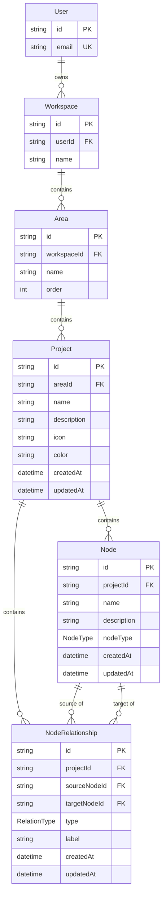
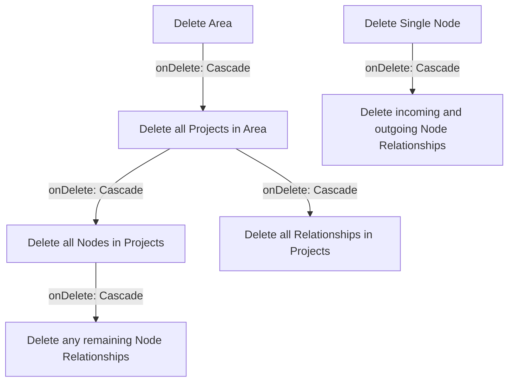

# Data Model: Feature 004 — Project & Node Management

**Feature**: Project & Node Management  
**Status**: Approved for Implementation  
**Date**: 2026-11-05  

This document details the relational data model, validation rules, constraints, and lifecycle operations for **Feature 004: Project & Node Management** in DevSpace.

---

## 1. Entity-Relationship Diagram



---

## 2. Relational Schema & Attributes

### `Project` Entity (`projects` table in PostgreSQL)

| Column | Type | Nullable | Default | Constraints / Validation | Description |
|---|---|:---:|:---:|---|---|
| `id` | `VARCHAR(30)` | No | `cuid()` | Primary Key | Unique identifier for the Project |
| `areaId` | `VARCHAR(30)` | No | - | Foreign Key -> `areas.id` (`ON DELETE CASCADE`) | The parent Area that exclusively owns this Project |
| `name` | `VARCHAR(50)` | No | - | 1–50 characters, trimmed of whitespace | Project title, unique per Area (case-insensitive) |
| `description` | `VARCHAR(280)`| Yes | `null` | Max 280 characters, trimmed of whitespace | Optional description or mission of the project |
| `icon` | `VARCHAR(50)` | No | `'Folder'` | Curated preset icon catalog token | Visual iconography for the project |
| `color` | `VARCHAR(50)` | No | `'cyan'` | Curated 8-color theme palette token | Theme accent color for cards and badges |
| `createdAt` | `TIMESTAMP` | No | `now()` | Immutable timestamp | Timestamp of project creation |
| `updatedAt` | `TIMESTAMP` | No | `now()` | Auto-updated on record changes | Timestamp of last modification |

**Indexes & Constraints**:
- `@@index([areaId])`: Optimizes listing projects within an Area.
- `@@index([areaId, updatedAt])`: Optimizes default recency sorting.
- `@@unique([areaId, name])`: Enforces unique project name per Area (case-insensitive checked in service).

---

### `Node` Entity (`nodes` table in PostgreSQL)

| Column | Type | Nullable | Default | Constraints / Validation | Description |
|---|---|:---:|:---:|---|---|
| `id` | `VARCHAR(30)` | No | `cuid()` | Primary Key | Unique identifier for the Node |
| `projectId` | `VARCHAR(30)` | No | - | Foreign Key -> `projects.id` (`ON DELETE CASCADE`) | The parent Project that exclusively owns this Node |
| `name` | `VARCHAR(50)` | No | - | 1–50 characters, trimmed of whitespace | Node title, unique per Project (case-insensitive) |
| `description` | `VARCHAR(280)`| Yes | `null` | Max 280 characters, trimmed of whitespace | Optional description of the conceptual node |
| `nodeType` | `NodeType` enum | No | `'CONCEPT'` | Enum: `CONCEPT`, `COMPONENT`, `SERVICE`, `MODULE`, `DATABASE`, `INTERFACE`, `CUSTOM` | Semantic architectural classification |
| `createdAt` | `TIMESTAMP` | No | `now()` | Immutable timestamp | Timestamp of node creation |
| `updatedAt` | `TIMESTAMP` | No | `now()` | Auto-updated on record changes | Timestamp of last modification |

**Indexes & Constraints**:
- `@@index([projectId])`: Optimizes listing nodes within a Project.
- `@@index([projectId, createdAt])`: Optimizes chronological node display.
- `@@unique([projectId, name])`: Enforces unique node name per Project.

---

### `NodeRelationship` Entity (`node_relationships` table in PostgreSQL)

| Column | Type | Nullable | Default | Constraints / Validation | Description |
|---|---|:---:|:---:|---|---|
| `id` | `VARCHAR(30)` | No | `cuid()` | Primary Key | Unique identifier for the relationship |
| `projectId` | `VARCHAR(30)` | No | - | Foreign Key -> `projects.id` (`ON DELETE CASCADE`) | Scopes the relationship strictly to one Project |
| `sourceNodeId` | `VARCHAR(30)` | No | - | Foreign Key -> `nodes.id` (`ON DELETE CASCADE`) | The originating conceptual node |
| `targetNodeId` | `VARCHAR(30)` | No | - | Foreign Key -> `nodes.id` (`ON DELETE CASCADE`) | The destination conceptual node |
| `type` | `RelationType` enum | No | `'RELATES_TO'` | Enum: `RELATES_TO`, `DEPENDS_ON`, `CONTAINS` | Semantic directed edge type |
| `label` | `VARCHAR(100)`| Yes | `null` | Max 100 characters, trimmed | Optional human-readable connection description |
| `createdAt` | `TIMESTAMP` | No | `now()` | Immutable timestamp | Timestamp of connection creation |
| `updatedAt` | `TIMESTAMP` | No | `now()` | Auto-updated on record changes | Timestamp of last modification |

**Indexes & Constraints**:
- `@@index([projectId])`: Fast retrieval of all relationships in a Project.
- `@@index([sourceNodeId])`: Fast lookup of outgoing relationships.
- `@@index([targetNodeId])`: Fast lookup of incoming relationships.
- `@@unique([projectId, sourceNodeId, targetNodeId, type])`: Prevents duplicate directed connections of the same type between the same node pair.
- Check constraint / Business rule: `sourceNodeId != targetNodeId` (self-referencing prohibited).

---

## 3. Prisma Schema Definition

```prisma
enum NodeType {
  CONCEPT
  COMPONENT
  SERVICE
  MODULE
  DATABASE
  INTERFACE
  CUSTOM

  @@map("node_types")
}

enum RelationType {
  RELATES_TO
  DEPENDS_ON
  CONTAINS

  @@map("relation_types")
}

model Project {
  id            String             @id @default(cuid())
  areaId        String
  name          String
  description   String?
  icon          String             @default("Folder")
  color         String             @default("cyan")
  createdAt     DateTime           @default(now())
  updatedAt     DateTime           @updatedAt

  area          Area               @relation(fields: [areaId], references: [id], onDelete: Cascade)
  nodes         Node[]
  relationships NodeRelationship[]

  @@index([areaId])
  @@index([areaId, updatedAt])
  @@unique([areaId, name])
  @@map("projects")
}

model Node {
  id                    String             @id @default(cuid())
  projectId             String
  name                  String
  description           String?
  nodeType              NodeType           @default(CONCEPT)
  createdAt             DateTime           @default(now())
  updatedAt             DateTime           @updatedAt

  project               Project            @relation(fields: [projectId], references: [id], onDelete: Cascade)
  outgoingRelationships NodeRelationship[] @relation("SourceNode")
  incomingRelationships NodeRelationship[] @relation("TargetNode")

  @@index([projectId])
  @@index([projectId, createdAt])
  @@unique([projectId, name])
  @@map("nodes")
}

model NodeRelationship {
  id           String       @id @default(cuid())
  projectId    String
  sourceNodeId String
  targetNodeId String
  type         RelationType @default(RELATES_TO)
  label        String?
  createdAt    DateTime     @default(now())
  updatedAt    DateTime     @updatedAt

  project      Project      @relation(fields: [projectId], references: [id], onDelete: Cascade)
  sourceNode   Node         @relation("SourceNode", fields: [sourceNodeId], references: [id], onDelete: Cascade)
  targetNode   Node         @relation("TargetNode", fields: [targetNodeId], references: [id], onDelete: Cascade)

  @@index([projectId])
  @@index([sourceNodeId])
  @@index([targetNodeId])
  @@unique([projectId, sourceNodeId, targetNodeId, type])
  @@map("node_relationships")
}
```

---

## 4. Cascading & Lifecycle Operations



- **Area Deletion**: Automatically removes all Projects belonging to the Area, cascading down to all Nodes and NodeRelationships in PostgreSQL.
- **Project Deletion**: Automatically removes all contained Nodes and all contained NodeRelationships.
- **Node Deletion**: Automatically removes all NodeRelationships where the deleted node is the `sourceNode` or `targetNode`. The remaining Nodes in the Project are completely unaffected.
- **NodeRelationship Deletion**: Removes the single directed relationship edge. Both connected Nodes remain completely untouched.

