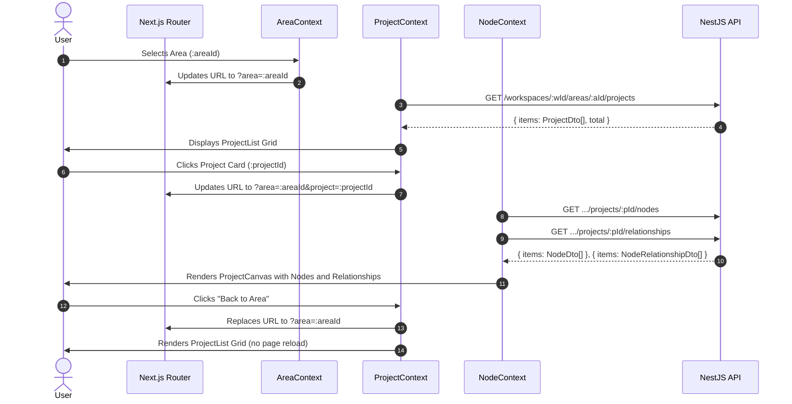

# Implementation Plan: Project & Node Management (Feature 004)

**Branch**: `feature/004-project-node-management` | **Date**: 2026-11-05 | **Spec**: [`spec.md`](./spec.md)  
**UX Direction**: [`ux-design.md`](./ux-design.md)  
**Research**: [`research.md`](./research.md)  
**Data Model**: [`data-model.md`](./data-model.md)  
**Contracts**: [`contracts/project.contract.ts`](./contracts/project.contract.ts), [`contracts/node.contract.ts`](./contracts/node.contract.ts)  
**Quickstart**: [`quickstart.md`](./quickstart.md)  

---

## Summary

Feature 004 introduces Project & Node Management into DevSpace, allowing users to organize their Areas into focused Projects (representing systems, initiatives, or repositories) and organize each Project into conceptual Nodes (representing architectural components, domain models, or entities). The technical implementation adds two modules to the NestJS backend (`apps/api`): `ProjectsModule` (nested under `/api/workspaces/:workspaceId/areas/:areaId/projects`) and `NodesModule` (nested under `/api/workspaces/:workspaceId/areas/:areaId/projects/:projectId/nodes` and `/relationships`). Persistence is managed via Prisma ORM with strict cascade deletion down the complete chain: `Area → Project → Node → NodeRelationship`. In the Next.js 15 frontend (`apps/web`), the static placeholder in `AreaCanvas` is replaced with a responsive 2D Project management canvas, supporting project cards, search/sorting, detail navigation via URL query parameters (`/workspaces/:workspaceId?area=:areaId&project=:projectId`), conceptual node lists with semantic badges, and basic directed node relationships. Strict authorization validates the full 5-level ownership chain (`User → Workspace → Area → Project → Node`), returning uniform `404 Not Found` responses to prevent resource enumeration.

---

## Technical Context

- **Language & Runtime**: Node.js LTS (v20+ / v22+), TypeScript 5.8+ across all packages.
- **Monorepo & Package Manager**: `pnpm` workspaces (v10.15.1) with three primary targets: `apps/api`, `apps/web`, and `packages/contracts`.
- **Backend Architecture**: NestJS (v11) Modular Monolith with Express, `@nestjs/jwt`, `@nestjs/swagger`, `class-validator`, and `class-transformer`.
- **Database & Persistence**: PostgreSQL with Prisma ORM (`prisma`, `@prisma/client`) located at `apps/api/prisma/schema.prisma`.
- **Authentication & Security**: Integrated with Feature 001 via `JwtAuthGuard` and `@CurrentUser()` decorator; atomic server-side ownership checks across the full hierarchy chain.
- **Frontend Architecture**: Next.js 15 (App Router), React 19, Tailwind CSS v3, `lucide-react`, React Context for Project and Node state management.
- **Target Platform**: Modern desktop and mobile web browsers (Chromium, Firefox, Safari).
- **Scale & Scope (MVP)**: Personal single-user workspaces; typical range 1–30 projects per area, 1–50 nodes per project; zero multi-user collaboration or sharing.
- **Performance Goals**: Under 300ms UI response times (`SC-008`); under 10s project creation (`SC-001`); under 8s node creation (`SC-002`); under 200ms p95 for API endpoints.
- **Constraints**: Strict 2D-first interface; zero Three.js or 3D visualization; no spatial coordinates (`positionX/Y/Z`); nodes are conceptual entities (NOT tasks); project progress tracking deferred to Feature 007.

---

## Constitution Check

*GATE: Verified against DevSpace Constitution v1.0.0*

| Principle | Gate Requirement | Status | Adherence Details |
|---|---|:---:|---|
| **I. Product Philosophy (2D-First, 3D-Enhanced)** | Core workspace management MUST be fully usable via standard 2D interfaces. | **PASS** | Project and Node CRUD, detail inspection, and relationship management are implemented entirely as responsive 2D cards, lists, dialogs, and detail panels. Zero 3D dependencies required. |
| **II. Monorepo & Modular Architecture** | Modular Monolith in NestJS, clear domain encapsulation, shared contracts package. | **PASS** | Projects and Nodes are encapsulated in `ProjectsModule` and `NodesModule` in `apps/api/src/modules/`. Shared DTOs and types live in `packages/contracts/src/projects` and `packages/contracts/src/nodes`. |
| **III. Engineering Standards** | Strict static type safety, no unnecessary `any`, decoupled business logic. | **PASS** | Full static type safety from database models to frontend components using TypeScript and `@devspace/contracts`. Business logic lives strictly in NestJS services. |
| **IV. Purposeful 3D Development** | 3D scenes completely decoupled from application business logic and data persistence. | **PASS** | No 3D visualization code, geometries, or spatial coordinate fields (`positionX/Y/Z`) are added to the data models or contracts. |
| **V. Pragmatic Quality & Testing** | Automated tests for critical logic and API contracts; no meaningless tests. | **PASS** | Comprehensive unit and integration test suites covering ownership chain validation, cascade deletes, duplicate name conflicts, self-referencing links, and component interactions. |
| **VI. Minimum Quality Gates** | `typecheck`, `lint`, automated tests, and `build` MUST pass. | **PASS** | Minimum quality verification gates are configured across all affected packages (`contracts`, `api`, `web`). |
| **VII. Spec-Driven Workflow** | Specify → Clarify → Plan → Tasks → Analyze → Implement. | **PASS** | Follows the structured Spec Kit lifecycle; fully clarified with 5/5 questions resolved in Session 2026-11-05. |

*Gate outcome: All constitutional gates passed with zero violations.*

---

## Project Structure

### Documentation (this feature)

```text
specs/004-project-node-management/
├── spec.md                  # Feature specification
├── checklists/
│   └── requirements.md      # Spec quality checklist
├── plan.md                  # This implementation plan
├── research.md              # Technical research and design decisions
├── data-model.md            # Relational schema and ER diagram
├── contracts/               # Shared API and DTO contracts
│   ├── project.contract.ts
│   └── node.contract.ts
└── quickstart.md            # Validation scenarios and testing guide
```

### Source Code Changes & Additions

```text
packages/contracts/
├── src/
│   ├── projects/
│   │   └── project.dto.ts
│   ├── nodes/
│   │   ├── node.dto.ts
│   │   └── node-relationship.dto.ts
│   └── index.ts             # Export projects and nodes contracts

apps/api/
├── prisma/
│   ├── schema.prisma        # Add Project, Node, NodeRelationship models and enums
│   └── migrations/          # Migration: add_projects_and_nodes
├── src/
│   ├── app.module.ts        # Register ProjectsModule and NodesModule
│   └── modules/
│       ├── projects/
│       │   ├── dto/
│       │   │   ├── create-project.dto.ts
│       │   │   └── update-project.dto.ts
│       │   ├── projects.controller.ts
│       │   ├── projects.service.ts
│       │   ├── projects.service.spec.ts
│       │   └── projects.module.ts
│       └── nodes/
│           ├── dto/
│           │   ├── create-node.dto.ts
│           │   ├── update-node.dto.ts
│           │   ├── create-node-relationship.dto.ts
│           │   └── update-node-relationship.dto.ts
│           ├── nodes.controller.ts
│           ├── nodes.service.ts
│           ├── nodes.service.spec.ts
│           ├── node-relationships.controller.ts
│           ├── node-relationships.service.ts
│           ├── node-relationships.service.spec.ts
│           └── nodes.module.ts
└── test/
    └── e2e/
        ├── projects.e2e-spec.ts
        ├── nodes.e2e-spec.ts
        ├── node-relationships.e2e-spec.ts
        ├── hierarchy-ownership.e2e-spec.ts
        └── cascade-integrity.e2e-spec.ts

apps/web/
├── src/
│   └── features/
│       ├── areas/
│       │   └── components/
│       │       └── area-canvas.tsx      # Embed ProjectSection within active area canvas
│       ├── projects/
│       │   ├── components/
│       │   │   ├── project-section.tsx
│       │   │   ├── project-card.tsx
│       │   │   ├── project-list.tsx
│       │   │   ├── project-canvas.tsx
│       │   │   ├── create-project-dialog.tsx
│       │   │   ├── edit-project-dialog.tsx
│       │   │   ├── delete-project-dialog.tsx
│       │   │   ├── area-empty-projects-state.tsx
│       │   │   ├── project-loading-skeleton.tsx
│       │   │   └── project-error-state.tsx
│       │   ├── context/
│       │   │   └── project-context.tsx
│       │   ├── hooks/
│       │   │   └── use-projects.ts
│       │   └── index.ts
│       └── nodes/
│           ├── components/
│           │   ├── node-section.tsx
│           │   ├── node-card.tsx
│           │   ├── node-list.tsx
│           │   ├── create-node-dialog.tsx
│           │   ├── edit-node-dialog.tsx
│           │   ├── delete-node-dialog.tsx
│           │   ├── project-empty-nodes-state.tsx
│           │   ├── node-relationship-list.tsx
│           │   └── create-relationship-dialog.tsx
│           ├── context/
│           │   └── node-context.tsx
│           ├── hooks/
│           │   └── use-nodes.ts
│           └── index.ts
```

---

## Detailed Technical Architecture

### 1. Database Schema & Prisma Migrations

Update `apps/api/prisma/schema.prisma` with:

```prisma
enum NodeType {
  CONCEPT
  COMPONENT
  SERVICE
  MODULE
  DATABASE
  INTERFACE
  CUSTOM

  @@map("node_types")
}

enum RelationType {
  RELATES_TO
  DEPENDS_ON
  CONTAINS

  @@map("relation_types")
}

model Project {
  id            String             @id @default(cuid())
  areaId        String
  name          String
  description   String?
  icon          String             @default("Folder")
  color         String             @default("cyan")
  createdAt     DateTime           @default(now())
  updatedAt     DateTime           @updatedAt

  area          Area               @relation(fields: [areaId], references: [id], onDelete: Cascade)
  nodes         Node[]
  relationships NodeRelationship[]

  @@index([areaId])
  @@index([areaId, updatedAt])
  @@unique([areaId, name])
  @@map("projects")
}

model Node {
  id                    String             @id @default(cuid())
  projectId             String
  name                  String
  description           String?
  nodeType              NodeType           @default(CONCEPT)
  createdAt             DateTime           @default(now())
  updatedAt             DateTime           @updatedAt

  project               Project            @relation(fields: [projectId], references: [id], onDelete: Cascade)
  outgoingRelationships NodeRelationship[] @relation("SourceNode")
  incomingRelationships NodeRelationship[] @relation("TargetNode")

  @@index([projectId])
  @@index([projectId, createdAt])
  @@unique([projectId, name])
  @@map("nodes")
}

model NodeRelationship {
  id           String       @id @default(cuid())
  projectId    String
  sourceNodeId String
  targetNodeId String
  type         RelationType @default(RELATES_TO)
  label        String?
  createdAt    DateTime     @default(now())
  updatedAt    DateTime     @updatedAt

  project      Project      @relation(fields: [projectId], references: [id], onDelete: Cascade)
  sourceNode   Node         @relation("SourceNode", fields: [sourceNodeId], references: [id], onDelete: Cascade)
  targetNode   Node         @relation("TargetNode", fields: [targetNodeId], references: [id], onDelete: Cascade)

  @@index([projectId])
  @@index([sourceNodeId])
  @@index([targetNodeId])
  @@unique([projectId, sourceNodeId, targetNodeId, type])
  @@map("node_relationships")
}
```

- Also update `model Area` in `schema.prisma` to include `projects Project[]`.
- Migration command: `pnpm --filter @devspace/api exec prisma migrate dev --name add_projects_and_nodes`.

---

### 2. Backend Modules & REST API Endpoints

#### Projects Module (`apps/api/src/modules/projects`)
- Controller: `@Controller('workspaces/:workspaceId/areas/:areaId/projects')`
  - `POST /` -> `create()` (201 Created)
  - `GET /` -> `findAll()` (200 OK) — returns `{ items: ProjectDto[], total: number }`, ordered by `updatedAt: 'desc'`
  - `GET /:projectId` -> `findOne()` (200 OK)
  - `PATCH /:projectId` -> `update()` (200 OK)
  - `DELETE /:projectId` -> `remove()` (204 No Content)
- Service: `ProjectsService`
  - Helper: `verifyAreaOwnership(userId, workspaceId, areaId)` using a single indexed relational query:
    ```typescript
    const area = await this.prisma.area.findFirst({
      where: { id: areaId, workspaceId, workspace: { userId } },
    });
    if (!area) throw new NotFoundException('Area not found');
    ```
  - Case-insensitive duplicate name check per Area:
    ```typescript
    const existing = await this.prisma.project.findFirst({
      where: { areaId, name: { equals: trimmedName, mode: 'insensitive' } },
    });
    if (existing) throw new ConflictException(`Project "${trimmedName}" already exists in this area`);
    ```
  - Computes `nodeCount` using `_count: { select: { nodes: true } }` on list and details queries.

#### Nodes Module (`apps/api/src/modules/nodes`)
- Controller: `@Controller('workspaces/:workspaceId/areas/:areaId/projects/:projectId/nodes')`
  - `POST /` -> `create()` (201 Created)
  - `GET /` -> `findAll()` (200 OK) — returns `{ items: NodeDto[], total: number }`, ordered by `createdAt: 'asc'`
  - `GET /:nodeId` -> `findOne()` (200 OK)
  - `PATCH /:nodeId` -> `update()` (200 OK)
  - `DELETE /:nodeId` -> `remove()` (204 No Content)
- Relationships Controller: `@Controller('workspaces/:workspaceId/areas/:areaId/projects/:projectId/relationships')`
  - `POST /` -> `create()` (201 Created)
  - `GET /` -> `findAll()` (200 OK) — returns `{ items: NodeRelationshipDto[], total: number }`
  - `PATCH /:relationshipId` -> `update()` (200 OK)
  - `DELETE /:relationshipId` -> `remove()` (204 No Content)
- Services: `NodesService` and `NodeRelationshipsService`
  - Helper: `verifyProjectOwnership(userId, workspaceId, areaId, projectId)`:
    ```typescript
    const project = await this.prisma.project.findFirst({
      where: {
        id: projectId,
        areaId,
        area: { workspaceId, workspace: { userId } },
      },
    });
    if (!project) throw new NotFoundException('Project not found');
    ```
  - Self-reference validation:
    ```typescript
    if (dto.sourceNodeId === dto.targetNodeId) {
      throw new BadRequestException('A node cannot have a relationship with itself');
    }
    ```
  - Both nodes verified to belong strictly to `projectId`:
    ```typescript
    const [source, target] = await Promise.all([
      this.prisma.node.findFirst({ where: { id: dto.sourceNodeId, projectId } }),
      this.prisma.node.findFirst({ where: { id: dto.targetNodeId, projectId } }),
    ]);
    if (!source || !target) {
      throw new NotFoundException('One or both nodes were not found in this project');
    }
    ```

---

### 3. Frontend Architecture & UI Integration

#### 1. Integration within `AreaCanvas` (`apps/web/src/features/areas/components/area-canvas.tsx`)
- Replace lines 93–104 with `<ProjectSection area={area} />`.
- `ProjectSection` renders inside `ProjectProvider`, which is scoped to the active `area.id`.

#### 2. Project Subsystem Components (`apps/web/src/features/projects/components/`)
- `ProjectList`: Renders the grid of project cards with sorting toggles (Recently Updated, Name A-Z, Oldest) and a `+ New Project` button.
- `ProjectCard`: Displays icon badge (reusing curated preset icons), theme accent border, title, description, node count pill, updated timestamp, and action menu (Edit, Delete).
- `ProjectCanvas`: Rendered when `?project=:projectId` is in the URL. Displays breadcrumb header (`Area > Project Name`), back button, project actions, and renders `<NodeSection project={activeProject} />`.
- `CreateProjectDialog` & `EditProjectDialog`: Reusable dialog forms with name validation (1–50 chars, trimmed), description input, icon picker, and color palette picker.
- `DeleteProjectDialog`: Destructive confirmation modal showing project name and node count warning.
- `AreaEmptyProjectsState`: Calm empty state rendered when an Area has 0 projects, directing the user to create their first project.

#### 3. Node Subsystem Components (`apps/web/src/features/nodes/components/`)
- `NodeSection`: Contains `NodeList` and optional `NodeRelationshipList`.
- `NodeList`: Grid/board of conceptual node cards, with type filter chips (`All`, `Concept`, `Component`, `Service`, `Module`, `Database`, `Interface`) and a `+ Add Node` button.
- `NodeCard`: Displays semantic badge with dedicated color/icon styling, title, description, and action menu.
- `CreateNodeDialog` & `EditNodeDialog`: Dialog form for name, semantic `nodeType` dropdown, and description.
- `DeleteNodeDialog`: Destructive confirmation modal for node removal.
- `ProjectEmptyNodesState`: Calm empty state explaining conceptual nodes with a `+ Add First Node` button.
- `NodeRelationshipList`: Visual list of directed connections between nodes:
  `[Source Node]` ──(type label)──▶ `[Target Node]` with quick delete control.
- `CreateRelationshipDialog`: Form selecting source node, target node (filtering out source node to prevent self-references), relationship type (`relates_to`, `depends_on`, `contains`), and optional label.

---

### 4. State Management & Navigation Flow



- **URL State**:
  - `?area=:areaId`: Shows project list for that area.
  - `?area=:areaId&project=:projectId`: Shows project detail canvas and nodes for that project.
  - Invalid `project` query param: Falls back to project list with a gentle toast notification.
- **Cache Invalidation**:
  - `createProject`, `updateProject`, `deleteProject` locally update the project list and re-fetch.
  - `createNode`, `updateNode`, `deleteNode` update the node collection and refresh relationship counts.
  - `deleteNode` removes associated relationships from local context immediately.

---

### 5. Testing & Quality Strategy

#### Backend Automated Tests
- `projects.service.spec.ts`:
  - `create()`: successfully creates project with trimmed name and default icon/color.
  - `create()`: throws `ConflictException` on case-insensitive duplicate project name in same area.
  - `findAllForArea()`: returns projects ordered by `updatedAt` desc with computed `nodeCount`.
  - `verifyAreaOwnership()`: throws `NotFoundException` if user does not own workspace or area.
  - `remove()`: deletes project and verifies cascade behavior.
- `nodes.service.spec.ts`:
  - `create()`: creates node with valid semantic `nodeType`.
  - `create()`: throws `ConflictException` on duplicate node name in same project.
  - `verifyProjectOwnership()`: throws `NotFoundException` on cross-tenant or mismatched area ID.
  - `remove()`: deletes node.
- `node-relationships.service.spec.ts`:
  - `create()`: creates directed relationship between two valid nodes in same project.
  - `create()`: throws `BadRequestException` on self-referencing relationship (`sourceNodeId === targetNodeId`).
  - `create()`: throws `NotFoundException` if either node does not belong to target project.
  - `create()`: throws `ConflictException` on duplicate directed relationship with same type.

#### Frontend Automated Tests
- `project-card.spec.tsx`: Renders title, description, node count, and responds to click.
- `create-project-dialog.spec.tsx`: Validates 1–50 char requirement, whitespace trimming, and icon/color selection.
- `node-card.spec.tsx`: Renders semantic type badge and actions.
- `create-relationship-dialog.spec.tsx`: Disables selected source node in target selector to prevent self-referencing.

---

### 6. Migration and Rollback Plan

1. **Migration Execution**:
   - `prisma migrate dev --name add_projects_and_nodes` creates PostgreSQL tables `projects`, `nodes`, `node_relationships`, and enums `node_types`, `relation_types`.
   - All foreign keys enforce `ON DELETE CASCADE`.
2. **Compatibility with Features 001–003**:
   - Existing tables (`users`, `profiles`, `sessions`, `workspaces`, `areas`) remain structurally untouched, with only a 1-to-many relation addition on `areas` to `projects`.
   - Zero breaking changes to existing endpoints or DTO contracts.
3. **Rollback Strategy**:
   - If migration rollback is required:
     `prisma migrate resolve --rolled-back add_projects_and_nodes` and `DROP TABLE node_relationships, nodes, projects CASCADE; DROP TYPE node_types, relation_types;`.

---

## Constitution Re-evaluation (Post-Design)

- **2D-First, 3D-Enhanced**: Confirmed. All features operate via standard 2D components; Three.js code is zero.
- **Monorepo & Modular Monolith**: Confirmed. Boundaries strictly maintained in `ProjectsModule`, `NodesModule`, and `@devspace/contracts`.
- **Engineering Standards**: Confirmed. Strict TypeScript static type safety without `any`.
- **Data Isolation**: Confirmed. Canonical models contain zero spatial coordinate fields (`positionX/Y/Z`).
- **Pragmatic Testing**: Confirmed. Test plan covers critical business logic, cascade integrity, and security checks.
- **Minimum Quality Gates**: Ready for execution during implementation (`typecheck`, `lint`, `test`, `build`).
