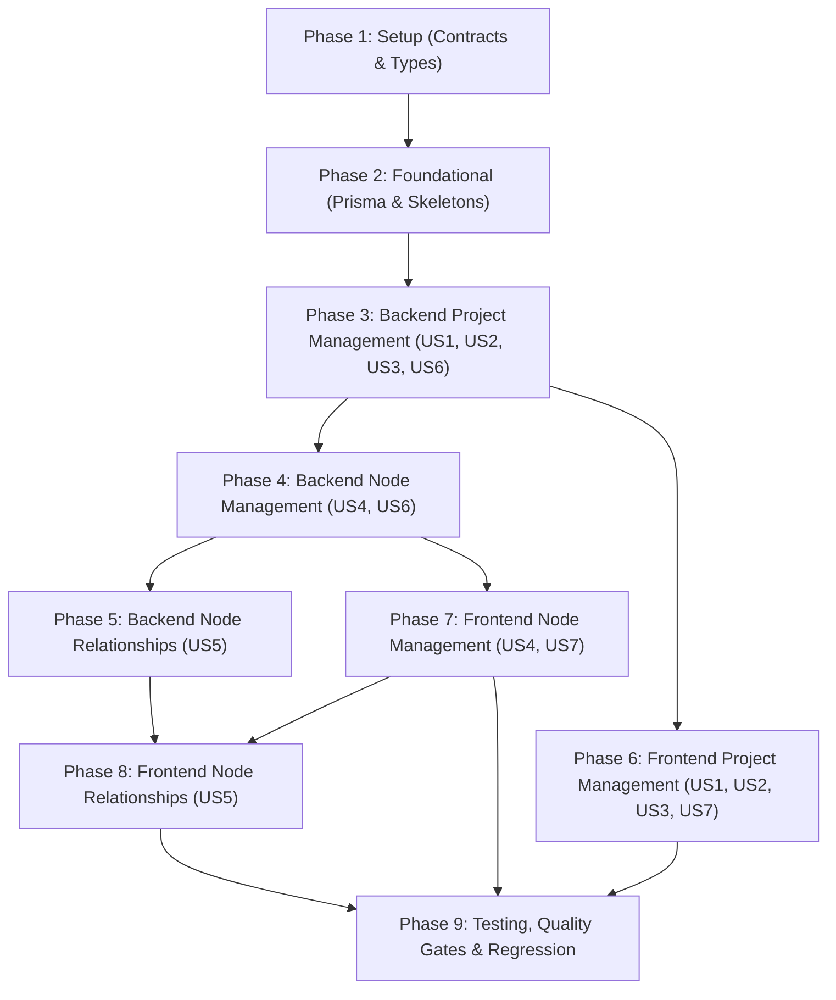

# Tasks: Project & Node Management (Feature 004)

**Input**: Design documents from `specs/004-project-node-management/`  
**Prerequisites**: [`plan.md`](./plan.md), [`spec.md`](./spec.md), [`ux-design.md`](./ux-design.md), [`data-model.md`](./data-model.md), [`contracts/project.contract.ts`](./contracts/project.contract.ts), [`contracts/node.contract.ts`](./contracts/node.contract.ts), [`quickstart.md`](./quickstart.md)  
**Organization**: Tasks are grouped by logical phase and prioritized user story to enable independent implementation and verification.

## Format: `[ID] [P?] [Story] Description with file path`

- **[P]**: Can run in parallel (different files, no dependencies)
- **[Story]**: User story identifier (`US1`, `US2`, `US3`, `US4`, `US5`, `US6`, `US7`)
- Exact file paths are specified for every task.

---

## Phase 1: Setup (Shared Contracts & Types)

**Purpose**: Define shared TypeScript interfaces, request/response contracts, and preset defaults for Projects, Nodes, and Relationships in `@devspace/contracts`.

- [ ] T001 [P] Define shared project contracts in `packages/contracts/src/projects/project.dto.ts` exporting `DEFAULT_PROJECT_ICON = 'Folder'`, `DEFAULT_PROJECT_COLOR = 'cyan'`, `ProjectDto`, `CreateProjectRequest`, `UpdateProjectRequest`, and `ProjectListResponse` reusing `WorkspaceIcon` and `WorkspaceColor`
- [ ] T002 [P] Define shared node contracts in `packages/contracts/src/nodes/node.dto.ts` exporting `NODE_TYPES = ['concept', 'component', 'service', 'module', 'database', 'interface', 'custom'] as const`, `type NodeType`, `DEFAULT_NODE_TYPE = 'concept'`, `NodeDto`, `CreateNodeRequest`, `UpdateNodeRequest`, and `NodeListResponse`
- [ ] T003 [P] Define shared node relationship contracts in `packages/contracts/src/nodes/node-relationship.dto.ts` exporting `RELATION_TYPES = ['relates_to', 'depends_on', 'contains'] as const`, `type RelationType`, `DEFAULT_RELATION_TYPE = 'relates_to'`, `NodeRelationshipDto`, `CreateNodeRelationshipRequest`, `UpdateNodeRelationshipRequest`, and `NodeRelationshipListResponse`
- [ ] T004 Export projects and nodes contracts in `packages/contracts/src/index.ts` and verify build via `pnpm --filter @devspace/contracts build`

---

## Phase 2: Foundational (Database Schema, Migration & Module Skeletons)

**Purpose**: Core database schema, Prisma migration, backend validation DTOs, and NestJS module skeletons. MUST be completed before story implementations.

- [ ] T005 Update `apps/api/prisma/schema.prisma` to add `NodeType` and `RelationType` enums, `Project`, `Node`, and `NodeRelationship` models with primary keys, indexes (`@@index([areaId])`, `@@index([areaId, updatedAt])`, `@@index([projectId])`, `@@index([projectId, createdAt])`, `@@index([sourceNodeId])`, `@@index([targetNodeId])`), compound unique constraints (`@@unique([areaId, name])`, `@@unique([projectId, name])`, `@@unique([projectId, sourceNodeId, targetNodeId, type])`), foreign key relations with `onDelete: Cascade`, and update `Area` model with `projects Project[]`
- [ ] T006 Generate database migration `add_projects_and_nodes` and regenerate Prisma client via `pnpm --filter @devspace/api exec prisma migrate dev --name add_projects_and_nodes` in `apps/api/prisma/migrations/`
- [ ] T007 [P] Create project validation DTOs with `class-validator` in `apps/api/src/modules/projects/dto/create-project.dto.ts` and `apps/api/src/modules/projects/dto/update-project.dto.ts` enforcing constraints (`name`: `@IsString()`, `@MinLength(1)`, `@MaxLength(50)`; `description`: `@IsOptional()`, `@IsString()`, `@MaxLength(280)`; `icon`: `@IsOptional()`, `@IsIn(WORKSPACE_ICONS)`; `color`: `@IsOptional()`, `@IsIn(WORKSPACE_COLORS)`)
- [ ] T008 [P] Create node validation DTOs with `class-validator` in `apps/api/src/modules/nodes/dto/create-node.dto.ts` and `apps/api/src/modules/nodes/dto/update-node.dto.ts` enforcing constraints (`name`: `@IsString()`, `@MinLength(1)`, `@MaxLength(50)`; `description`: `@IsOptional()`, `@IsString()`, `@MaxLength(280)`; `nodeType`: `@IsOptional()`, `@IsIn(NODE_TYPES)`)
- [ ] T009 [P] Create relationship validation DTOs with `class-validator` in `apps/api/src/modules/nodes/dto/create-node-relationship.dto.ts` and `apps/api/src/modules/nodes/dto/update-node-relationship.dto.ts` enforcing constraints (`sourceNodeId`: `@IsString()`, `@IsNotEmpty()`; `targetNodeId`: `@IsString()`, `@IsNotEmpty()`; `type`: `@IsOptional()`, `@IsIn(RELATION_TYPES)`; `label`: `@IsOptional()`, `@IsString()`, `@MaxLength(100)`)
- [ ] T010 Create `ProjectsModule` and `NodesModule` skeletons in `apps/api/src/modules/projects/projects.module.ts` and `apps/api/src/modules/nodes/nodes.module.ts`, and register both in `apps/api/src/app.module.ts`

**Checkpoint**: Foundation ready — database schema migrated with cascading foreign keys, backend module skeletons registered, shared contracts verified.

---

## Phase 3: Backend Project Management & Ownership Validation (US1, US2, US3, US6)

**Goal**: Implement backend Project CRUD operations nested under `/workspaces/:workspaceId/areas/:areaId/projects`, enforcing 3-tier ownership verification (`User → Workspace → Area`), unique name validation per Area, automatic recency sorting, and cascade deletion.

**Independent Test**: Use test scripts or Postman to create a project under an Area, retrieve the list, update its details, verify duplicate name conflict rejection (`409 Conflict`), and confirm unauthorized requests return `404 Not Found`.

- [ ] T011 [P] [US1] [US6] Unit tests for `ProjectsService` in `apps/api/src/modules/projects/projects.service.spec.ts` testing `verifyAreaOwnership` (throws 404 on mismatched workspace or user), `create` (trims whitespace, applies default icon/color, rejects duplicate name with 409), `findAllForArea` (orders by `updatedAt` desc and aggregates `nodeCount`), `findOne`, `update`, and `remove`
- [ ] T012 [US1] [US6] Implement `verifyAreaOwnership` helper and `ProjectsService.create` in `apps/api/src/modules/projects/projects.service.ts` validating that `areaId` belongs to `workspaceId` and `userId`, trimming `name`, checking case-insensitive duplicate per Area, and persisting record via `prisma.project.create`
- [ ] T013 [US2] Implement `ProjectsService.findAllForArea` and `ProjectsService.findOne` in `apps/api/src/modules/projects/projects.service.ts` returning projects ordered by `updatedAt: 'desc'` with computed `nodeCount` via `_count: { select: { nodes: true } }`
- [ ] T014 [US3] Implement `ProjectsService.update` and `ProjectsService.remove` in `apps/api/src/modules/projects/projects.service.ts` validating Area ownership, checking name uniqueness on rename, and executing cascade deletion
- [ ] T015 [US1] [US2] [US3] [US6] Implement `ProjectsController` in `apps/api/src/modules/projects/projects.controller.ts` with `@UseGuards(JwtAuthGuard)` and `@CurrentUser()` exposing `POST /`, `GET /`, `GET /:projectId`, `PATCH /:projectId`, and `DELETE /:projectId` under `@Controller('workspaces/:workspaceId/areas/:areaId/projects')`
- [ ] T016 [US1] [US6] API integration test for Project CRUD, Area ownership verification, and duplicate conflict handling in `apps/api/test/e2e/projects.e2e-spec.ts`

**Checkpoint**: Backend Project management is fully functional, isolated, and verified with automated tests.

---

## Phase 4: Backend Node Management & Project Ownership Validation (US4, US6)

**Goal**: Implement backend Node CRUD operations nested under `/workspaces/:workspaceId/areas/:areaId/projects/:projectId/nodes`, enforcing 4-tier ownership verification (`User → Workspace → Area → Project`), unique node names per Project, curated semantic node types, and cascade deletion.

**Independent Test**: Create multiple nodes with different types (`concept`, `component`, `database`) within a project, retrieve the node list, update a node, verify duplicate name rejection, and confirm cross-tenant requests return `404 Not Found`.

- [ ] T017 [P] [US4] [US6] Unit tests for `NodesService` in `apps/api/src/modules/nodes/nodes.service.spec.ts` testing `verifyProjectOwnership` (throws 404 on mismatched area/workspace/user), `create` (validates nodeType enum, trims name, rejects duplicate name with 409), `findAllForProject` (orders by `createdAt` asc), `findOne`, `update`, and `remove`
- [ ] T018 [US4] [US6] Implement `verifyProjectOwnership` helper and `NodesService.create` in `apps/api/src/modules/nodes/nodes.service.ts` validating that `projectId` belongs to `areaId`, `workspaceId`, and `userId`, trimming `name`, validating `nodeType` (defaulting to `CONCEPT`), checking case-insensitive name uniqueness within the project, and creating record via `prisma.node.create`
- [ ] T019 [US4] Implement `NodesService.findAllForProject` and `NodesService.findOne` in `apps/api/src/modules/nodes/nodes.service.ts` returning unpaginated node collections ordered by `createdAt: 'asc'`
- [ ] T020 [US4] Implement `NodesService.update` and `NodesService.remove` in `apps/api/src/modules/nodes/nodes.service.ts` validating Project ownership, checking duplicate names on rename, and executing cascade deletion of node and associated relationships
- [ ] T021 [US4] [US6] Implement `NodesController` in `apps/api/src/modules/nodes/nodes.controller.ts` with `@UseGuards(JwtAuthGuard)` and `@CurrentUser()` exposing `POST /`, `GET /`, `GET /:nodeId`, `PATCH /:nodeId`, and `DELETE /:nodeId` under `@Controller('workspaces/:workspaceId/areas/:areaId/projects/:projectId/nodes')`
- [ ] T022 [US4] [US6] API integration test for Node CRUD, Project ownership chain verification, and duplicate conflict handling in `apps/api/test/e2e/nodes.e2e-spec.ts`

**Checkpoint**: Backend Node management is fully functional and isolated.

---

## Phase 5: Backend Node Relationships (US5 - Should Have)

**Goal**: Implement backend Node Relationship CRUD nested under `/workspaces/:workspaceId/areas/:areaId/projects/:projectId/relationships`, prohibiting self-referencing links, verifying that both nodes belong strictly to the project, preventing duplicate directed edges, and deleting edges when connected nodes are deleted.

**Independent Test**: Connect two nodes in a project with `depends_on`, verify self-connection is blocked with 400 Bad Request, verify cross-project node connection is blocked with 404 Not Found, and verify deleting a node removes its relationships.

- [ ] T023 [P] [US5] Unit tests for `NodeRelationshipsService` in `apps/api/src/modules/nodes/node-relationships.service.spec.ts` testing self-reference rejection (`sourceNodeId === targetNodeId`), cross-project node rejection, duplicate edge conflict rejection (`409 Conflict`), `create`, `findAllForProject`, `update`, and `remove`
- [ ] T024 [US5] Implement `NodeRelationshipsService` in `apps/api/src/modules/nodes/node-relationships.service.ts` verifying project ownership, rejecting self-references, verifying both source and target nodes exist in the project, enforcing compound uniqueness on `[projectId, sourceNodeId, targetNodeId, type]`, and managing relationship CRUD
- [ ] T025 [US5] Implement `NodeRelationshipsController` in `apps/api/src/modules/nodes/node-relationships.controller.ts` exposing `POST /`, `GET /`, `PATCH /:relationshipId`, and `DELETE /:relationshipId` under `@Controller('workspaces/:workspaceId/areas/:areaId/projects/:projectId/relationships')`
- [ ] T026 [US5] API integration test for Node Relationships, self-reference prevention, duplicate edge rejection, and cascade deletion on node delete in `apps/api/test/e2e/node-relationships.e2e-spec.ts`

**Checkpoint**: Backend Node Relationship management is verified and operational.

---

## Phase 6: Frontend Project Management (US1, US2, US3, US7)

**Goal**: Build the 2D Project management frontend in Next.js 15, replacing the static placeholder in `AreaCanvas` with a project grid, card actions, search/sort controls, accessible dialog modals, and URL query parameter synchronization (`/workspaces/:workspaceId?area=:areaId&project=:projectId`).

**Independent Test**: Navigate to an Area, verify empty state with CTA, create a Project with custom icon and theme color, confirm project card renders with node counter, edit project, delete project via confirmation dialog, and toggle sorting.

- [ ] T027 [P] [US1] [US2] Implement `ProjectContext` and `useProjects` hook in `apps/web/src/features/projects/context/project-context.tsx` and `apps/web/src/features/projects/hooks/use-projects.ts` managing `projects: ProjectDto[]`, `activeProject: ProjectDto | null`, `isLoading: boolean`, `error: string | null`, and CRUD actions for a given `workspaceId` and `areaId`
- [ ] T028 [P] [US7] Implement `AreaEmptyProjectsState` in `apps/web/src/features/projects/components/area-empty-projects-state.tsx` displaying a `"Folder"` icon badge, title, explanatory text, and a primary `+ Create First Project` button
- [ ] T029 [P] [US7] Implement `ProjectLoadingSkeleton` and `ProjectErrorState` in `apps/web/src/features/projects/components/project-loading-skeleton.tsx` and `apps/web/src/features/projects/components/project-error-state.tsx`
- [ ] T030 [P] [US1] Implement `CreateProjectDialog` modal in `apps/web/src/features/projects/components/create-project-dialog.tsx` with name input (1–50 chars), description textarea (max 280 chars), `<IconPicker />`, `<ColorPicker />`, inline duplicate name validation, and loading state
- [ ] T031 [P] [US3] Implement `EditProjectDialog` and `DeleteProjectDialog` in `apps/web/src/features/projects/components/edit-project-dialog.tsx` and `apps/web/src/features/projects/components/delete-project-dialog.tsx` displaying destructive warning modal with project name and node count warning
- [ ] T032 [US2] Implement `ProjectCard` component in `apps/web/src/features/projects/components/project-card.tsx` rendering theme icon badge, accent color border, title, description, node count pill, updated timestamp, and dropdown menu (Edit, Delete)
- [ ] T033 [US2] Implement `ProjectList` component in `apps/web/src/features/projects/components/project-list.tsx` rendering project grid, search input, sort dropdown (Recently Updated, Name A-Z, Oldest), and `+ New Project` button
- [ ] T034 [US1] [US2] Implement `ProjectSection` container in `apps/web/src/features/projects/components/project-section.tsx` managing `ProjectProvider` and switching between `ProjectList` and `ProjectCanvas` based on URL query parameter `project`
- [ ] T035 [US2] Embed `ProjectSection` into `AreaCanvas` in `apps/web/src/features/areas/components/area-canvas.tsx` replacing the static dashed staging placeholder
- [ ] T036 Export project components and hooks in `apps/web/src/features/projects/index.ts`

**Checkpoint**: 2D Project management is integrated, responsive, and verified inside the active Area canvas.

---

## Phase 7: Frontend Node Management (US4, US7)

**Goal**: Build the 2D Node management interface inside `ProjectCanvas`, supporting conceptual node cards, semantic type badges (`concept`, `component`, `service`, `module`, `database`, `interface`, `custom`), type filtering, create/edit/delete dialogs, and empty states.

**Independent Test**: Click a project card to open `ProjectCanvas`, verify empty node state, create conceptual nodes with diverse types, filter by type, edit node details, and confirm delete confirmation removes the node.

- [ ] T037 [P] [US4] Implement `NodeContext` and `useNodes` hook in `apps/web/src/features/nodes/context/node-context.tsx` and `apps/web/src/features/nodes/hooks/use-nodes.ts` managing `nodes: NodeDto[]`, `relationships: NodeRelationshipDto[]`, `isLoading: boolean`, and CRUD actions for a given `workspaceId`, `areaId`, and `projectId`
- [ ] T038 [P] [US7] Implement `ProjectEmptyNodesState` in `apps/web/src/features/nodes/components/project-empty-nodes-state.tsx` explaining conceptual building blocks with a `+ Add First Node` button
- [ ] T039 [P] [US4] Implement `CreateNodeDialog` modal in `apps/web/src/features/nodes/components/create-node-dialog.tsx` with name input, semantic `nodeType` dropdown (with badge preview), description textarea, and inline validation
- [ ] T040 [P] [US4] Implement `EditNodeDialog` and `DeleteNodeDialog` in `apps/web/src/features/nodes/components/edit-node-dialog.tsx` and `apps/web/src/features/nodes/components/delete-node-dialog.tsx`
- [ ] T041 [US4] Implement `NodeCard` in `apps/web/src/features/nodes/components/node-card.tsx` displaying semantic type badge (`concept`, `component`, `service`, `module`, `database`, `interface`, `custom`), node title, description, and action menu
- [ ] T042 [US4] Implement `NodeList` in `apps/web/src/features/nodes/components/node-list.tsx` with type filter chips (`All`, `Concept`, `Component`, etc.), search input, and `+ Add Node` button
- [ ] T043 [US2] [US4] Implement `ProjectCanvas` in `apps/web/src/features/projects/components/project-canvas.tsx` with breadcrumb navigation (`Area > Project Name`), back button to Area project grid, project metadata bar, and node management container `<NodeSection project={project} />`
- [ ] T044 Implement `NodeSection` container in `apps/web/src/features/nodes/components/node-section.tsx` wiring `NodeProvider`, `NodeList`, and relationship view toggle
- [ ] T045 Export node components and hooks in `apps/web/src/features/nodes/index.ts`

**Checkpoint**: Conceptual Node management is functional, styled, and navigable within the Project canvas.

---

## Phase 8: Frontend Node Relationships (US5 - Should Have)

**Goal**: Build basic visual relationship management within `ProjectCanvas`, allowing users to connect nodes, view directed connections with semantic badges, and delete connections without 3D scene dependencies.

**Independent Test**: Connect Node A to Node B with type `depends_on`, verify self-connection is disabled in the dropdown, confirm the directed connection appears in the relationship list, and delete the connection.

- [ ] T046 [P] [US5] Implement `CreateRelationshipDialog` in `apps/web/src/features/nodes/components/create-relationship-dialog.tsx` with source node selector, target node selector (filtering out the selected source node to prevent self-referencing), relationship type dropdown (`relates_to`, `depends_on`, `contains`), optional label input (max 100 chars), and submission state
- [ ] T047 [P] [US5] Implement `NodeRelationshipList` in `apps/web/src/features/nodes/components/node-relationship-list.tsx` rendering directed connection items: `[Source Node]` ──(type badge + label)──▶ `[Target Node]` with inline delete action
- [ ] T048 [US5] Wire relationship actions in `NodeContext` (`apps/web/src/features/nodes/context/node-context.tsx`) connecting to backend relationship endpoints and updating local state immediately
- [ ] T049 [US5] Integrate `NodeRelationshipList` and connection triggers into `NodeSection` (`apps/web/src/features/nodes/components/node-section.tsx`) with an expandable/collapsible relationship drawer or tab

**Checkpoint**: Node Relationship management is operational in the 2D interface.

---

## Phase 9: Testing, Quality Gates & Full Regression Verification

**Purpose**: Execute comprehensive automated test suites, verify data cascade integrity, test multi-tenant security boundaries, verify backward compatibility with Features 001–003, and pass all minimum quality gates.

- [ ] T050 [P] End-to-end integration test verifying complete hierarchy ownership enforcement (`User → Workspace → Area → Project → Node → Relationship`) and uniform 404 responses for cross-tenant access in `apps/api/test/e2e/hierarchy-ownership.e2e-spec.ts`
- [ ] T051 [P] Data cascade integrity test verifying that deleting an Area deletes all its Projects, Nodes, and Relationships, and deleting a Node removes its associated relationships in `apps/api/test/e2e/cascade-integrity.e2e-spec.ts`
- [ ] T052 Regression verification test running existing Feature 001 (Auth), Feature 002 (Workspaces), and Feature 003 (Areas) test suites ensuring zero regressions: `pnpm --filter @devspace/api test`
- [ ] T053 Execute Monorepo Typecheck Gate across all packages: `pnpm typecheck`
- [ ] T054 Execute Monorepo Lint Gate across all packages: `pnpm lint`
- [ ] T055 Execute Monorepo Production Build Gate: `pnpm build`
- [ ] T056 Run manual end-to-end quickstart scenarios from `specs/004-project-node-management/quickstart.md` confirming all acceptance scenarios pass

---

## Dependencies & Execution Order

### Phase Dependencies

### Critical Path & MVP Execution Order
1. **MVP Scope (Projects & Nodes CRUD)**: Phase 1 → Phase 2 → Phase 3 → Phase 4 → Phase 6 → Phase 7.
2. **Secondary Phase (Relationships - Should Have)**: Phase 5 → Phase 8.
3. **Final Verification**: Phase 9.

### Parallel Opportunities

- **Contracts**: T001, T002, T003 can be written in parallel.
- **DTOs**: T007, T008, T009 can be written in parallel.
- **Backend Tests**: T011, T017, T023 can be prepared in parallel with service implementations.
- **Frontend Components**: T028, T029, T030, T031 can be developed in parallel; T038, T039, T040 can be developed in parallel.
- **Final Verification**: T050, T051, T052 can run concurrently.

---

## Implementation Notes

- **Zero 3D Dependencies**: No Three.js, geometry, or spatial positioning code (`positionX/Y/Z`) is to be introduced in any task.
- **Pure Conceptual Nodes**: Nodes must not contain task properties (`status`, `assignee`, `dueDate`).
- **Personal Workspace Scale**: Return unpaginated collection responses (`{ items, total }`) for both Projects and Nodes.
- **Cascade Guarantee**: Referential integrity is enforced at the database level via `onDelete: Cascade` in PostgreSQL.

